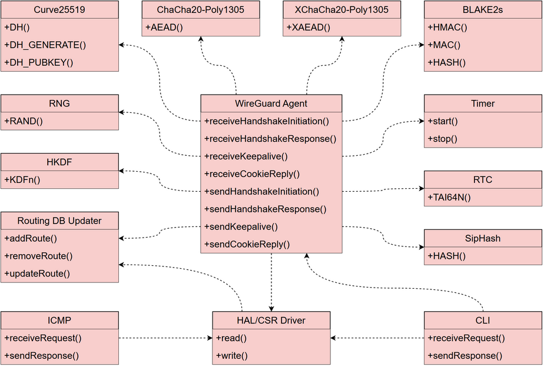
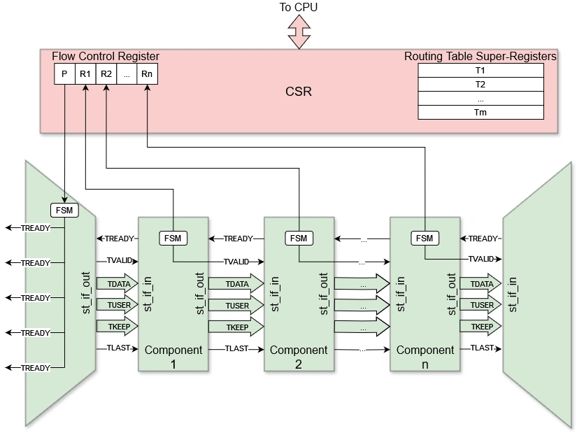
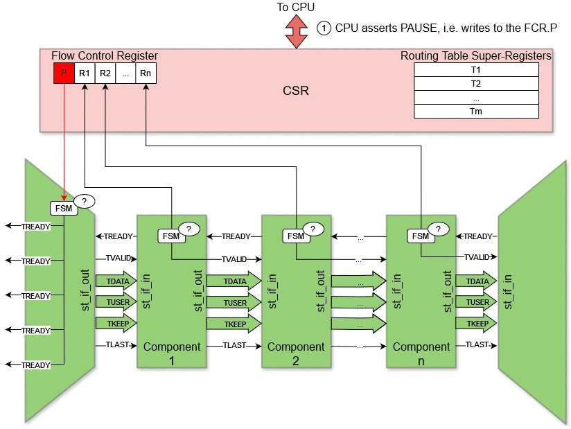

<!--
SPDX-FileCopyrightText: 2026 Chili.CHIPS*ba

SPDX-License-Identifier: BSD-3-Clause
-->

# Software Architecture and Theory of Operation


The conceptual class diagram provides an overview of the components in the software part of the system without delving into implementation details. The focus is on the WireGuard Agent, which implements the protocol's handshake procedures, along with the following supplementary components:
- [Curve25519](http://cr.yp.to/ecdh.html) - an ECDH algorithm implementation for establishing a shared secret using a public-private key pair between two remote parties connected via an insecure channel, such as the Internet
- ChaCha20-Poly1305 - an AEAD algorithm implementation for encryption and authentication of static keys and nonce values to prevent replay attacks
- XChaCha20-Poly1305 - the XAEAD that encrypts and authenticates the cookie in cookie reply messages, against DoS (see [Cookies](#cookies))
- [BLAKE2s](https://www.blake2.net) - an implementation of the BLAKE2s hash function for MAC authentication and keyed hashing, per [RFC7693](https://datatracker.ietf.org/doc/html/rfc7693)
- [RNG](#random-number-generator-lib) - a ChaCha20 DRBG, seeded from the ring-oscillator TRNG; it supplies the ephemeral keys, receiver indices and secrets
- Timer - cycle-counter timer; rekey, retry, and keepalive timers are planned
- [HKDF](https://eprint.iacr.org/2010/264) - an implementation of the algorithm for expanding the ECDH result
- [Noise handshake](#noise-handshake) - WireGuard's Noise_IKpsk2 initiation and response, and the transport keys; tested against Linux WireGuard
- [RTC](#timestamps-across-a-reboot) - a real-time clock for the TAI64N timestamp, kept increasing across a reboot by a mark in flash
- [SipHash](https://en.wikipedia.org/wiki/SipHash) - a keyed hash (SipHash-2-4) behind the hash table that finds a peer by its decrypted static public key; its secret key keeps an attacker from flooding the table
- Routing DB Updater - a subsystem for maintaining the cryptokey routing table content and deploying it to the data plane via the HAL/CSR interface
- ICMP - implementing basic ICMP protocol functions (echo request/reply, TTL exceeded, etc.)
- CLI - a USB/UART-based command-line interface for configuring the WireGuard node (setting the local IP address, remote peer IP addresses, network addresses, keys, etc.)
- HAL/CSR Driver - a CSR-based abstraction for DPE components with an interface for reading/writing the corresponding registers

### Status (2026-11)
The firmware now runs WireGuard's handshake end to end, and talks to Linux WireGuard:

| Area | What is new | Tested |
|---|---|---|
| [Sessions](#sessions-from-a-handshake-to-the-data-plane) ([#28](https://github.com/chili-chips/wireguard-fpga/issues/28)) | `wg_session.c`: handshake over UDP, replay check, keys written to the cryptokey table under pause/drain, CLI `wg ...` | 53 checks; Linux kernel interop |
| [Cookies](#cookies) ([#29](https://github.com/chili-chips/wireguard-fpga/issues/29)) | `cookie.c`, `xchacha20poly1305.c`: mac2 and cookie replies (message 3) | 271 checks; kernel interop under load |
| [Timestamps](#timestamps-across-a-reboot) ([#30](https://github.com/chili-chips/wireguard-fpga/issues/30)) | `rtc.c`, `flash.c`: RTC plus a high-water mark in SPI flash; CLI `clock`, `flash id` | RTL bench with a flash model |
| [Random numbers](#random-number-generator-lib) ([#2](https://github.com/chili-chips/wireguard-fpga/issues/2)) | `random.c`: BLAKE2s seed from `csr.trng`, ChaCha20 DRBG; refuses on a failed health test | Python reference; RTL bench of the TRNG |
| [Noise](#noise-handshake) | Explicit handshake states; a rejected message leaves the state untouched; secrets wiped with `bare_wipe` (volatile stores, which the compiler cannot drop) | 236 checks |

Still open: the TRNG's entropy, measured on hardware; rekey timers; ARP; detecting load ([#4](https://github.com/chili-chips/wireguard-fpga/issues/4)).

Image: `-march=rv32im`, the unwind tables (`.eh_frame`) dropped in `link_map.lds`. IMEM 52,124 of 64 KiB (80%), DMEM 40,488 of 64 KiB with the 4 KiB stack (62%).

## curve25519 (x25519) lib
This component provides a minimal Curve25519 (X25519) implementation used for
Elliptic Curve Diffie–Hellman (ECDH) key exchange within the Noise protocol
as used by WireGuard.

`x25519.c` follows [RFC 7748](https://www.rfc-editor.org/rfc/rfc7748) (the function, the Montgomery ladder) and the field arithmetic of ref10 ([SUPERCOP](https://bench.cr.yp.to/supercop.html), public domain). `curve25519.c` wraps it for public key generation and shared secret computation.

It replaced TweetNaCl's X25519, which is written to be short, not fast: 81.3 M cycles per call on the RTL eduBOS5 even with the hardware multiplier (1.02 s at 80 MHz), so a handshake side (about 5 calls) would take about 5 s, WireGuard's `REKEY_TIMEOUT`.

### Provided Functionality
- X25519 scalar multiplication
- Public key generation from a private scalar
- Shared secret computation for ECDH

### Implementation Notes
- Field elements: 10 signed 32-bit limbs, 26 and 25 bits wide in turn (radix 2^25.5). A limb product is one `mul` + `mulh`: 100 per field multiply, 55 per square, unrolled. TweetNaCl took 256 64x64 multiplies for either.
- Inversion: ref10's addition chain, 254 squares and 11 multiplies (TweetNaCl: 254 + 252).
- Constant time: no branch or memory index depends on a secret; the ladder swaps with a mask, and eduBOS5's `mul`/`mulh` take a fixed cycle count.
- The limb bounds keep every 32-bit factor below 2^31 and every 64-bit sum below 2^62 (comment in `x25519.c`).
- No dynamic memory allocation, no libgcc calls.

### API Overview
- `curve25519_generate_public_key(uint8_t public_key[32], const uint8_t private_key[32])`  
  Computes the public key using scalar multiplication with the Curve25519 base point.

- `curve25519_compute_shared_secret(uint8_t shared_secret[32], const uint8_t private_key[32], const uint8_t public_key[32])`  
  Computes the shared secret using scalar multiplication with a peer’s public key.

### Testing and Validation
- The implementation was [**successfully tested**](https://github.com/chili-chips/wireguard-fpga/tree/main/99.warmup/7.curve25519) using known-good key pairs and
  shared secret comparisons.
- `x25519.c` passes the RFC 7748 vectors (5.2, including the 1000-iteration one, and 6.1), and matches TweetNaCl on 20,000 random and 500 edge-case inputs (u = 0, 1, p-1, p, p+1, 2^255-1, an order-8 point), on the host, under UBSan and ASan.

## ChaCha20-Poly1305 lib
This component implements the ChaCha20–Poly1305 authenticated encryption
algorithm (AEAD) as specified in RFC 8439.

It combines a standalone ChaCha20 stream cipher implementation with a
Poly1305 message authentication code to provide confidentiality, integrity,
and authenticity. The library is intended for use within the Noise protocol
as used by WireGuard and is suitable for bare-metal embedded systems.

All cryptographic operations are implemented in portable C using explicit
bit manipulation and integer arithmetic, without relying on platform-specific
accelerations.

### Provided Functionality
- ChaCha20 stream cipher
- Poly1305 message authentication code
- ChaCha20–Poly1305 AEAD encryption and decryption
- Support for Additional Authenticated Data (AAD)

### Component Overview
#### ChaCha20
- 256-bit key, 96-bit nonce
- 64-byte block size
- Counter-based stream cipher
- Same function used for encryption and decryption

#### Poly1305
- One-time message authentication code
- 128-bit authentication tag
- Key derived from ChaCha20 keystream as per RFC 8439
- Five 26-bit limbs: 32x32->64 multiplies only (hardware `mul`/`mulhu` on eduBOS5's RV32M; it also builds for RV32I)
- Incremental API (`poly1305_init`/`update`/`finish`), any length and alignment
- Constant-time tag compare (`poly1305_verify`)

#### ChaCha20–Poly1305 AEAD
- Encrypt-then-MAC construction
- Produces a 16-byte authentication tag
- Feeds Poly1305 piece by piece (AAD, pad, ciphertext, pad, lengths): no copy, no length limit
- Verifies integrity before accepting decrypted data
- `test chacha20poly1305` (CLI) checks the RFC 8439 2.5.2 and 2.8.2 vectors

### Implementation Notes
- Follows RFC 8439 specification.
- Uses explicit bitwise operations (XOR, shifts, rotations).
- No dynamic memory allocation.
- Designed for bare-metal environments.
- Portable across architectures.
- Suitable for Noise / WireGuard usage.
- [**Successfully tested on real hardware.**](https://github.com/chili-chips/wireguard-fpga/tree/main/99.warmup/6.chacha20poly1305_picoRV32)

## BLAKE2s lib
This component provides a compact and self-contained reference implementation of the
BLAKE2s cryptographic hash function.

The implementation is written in portable C and is designed to run on both x86 and
32-bit RISC-V (RV32) architectures without relying on platform-specific intrinsics.
All core operations are implemented using explicit bit manipulation and integer
arithmetic, ensuring predictable behavior across different targets.

This library is used as a fundamental cryptographic primitive within the Noise protocol
implementation for WireGuard, including hashing, key derivation, and HMAC construction.

### Provided Functionality
- BLAKE2s hash (incremental API: init / update / final)
- One-shot hash helper function
- HMAC based on BLAKE2s

### Implementation Notes
- Implements the official BLAKE2s compression function and permutation (based on: "A clean & simple implementation of BLAKE2b and [BLAKE2s](https://github.com/mjosaarinen/blake2_mjosref) hash functions -- written while writing the RFC.")
- Uses explicit bitwise operations (XOR, shifts, rotations) and 32-bit arithmetic.
- Little-endian data handling is implemented manually for portability.
- No dynamic memory allocation.
- Suitable for bare-metal and hosted environments.
- Compatible with x86 and RV32 architectures.
- [**Successfully tested on real hardware.**](https://github.com/chili-chips/wireguard-fpga/tree/main/99.warmup/8.BLAKE2s)

## Random number generator lib
`random.c` turns raw hardware entropy into random numbers ([#2](https://github.com/chili-chips/wireguard-fpga/issues/2)). Hardware, entropy claim and health tests: [`1.hw/ip.infra/trng`](../1.hw/ip.infra/trng/README.md).

### Provided Functions
- `random_bytes(uint8_t *out, size_t n)`: up to 1024 bytes; 0, or an error (`RANDOM_ERR_*`) with `out` zeroed.
- `random_32bytes(uint8_t *out)`: 32 bytes; on an error it halts with a message.
- `random_range(uint32_t min, uint32_t max)`: uniform in `[min, max]` by rejection sampling: draws below 2^32 mod span are drawn again, so there is no modulo bias. Halts on an error.

### Implementation Notes
- **Source:** `csr.trng`, two ring-oscillator banks with the SP 800-90B Repetition Count and Adaptive Proportion tests in hardware. Claim: 0.5 bit of min-entropy per raw sample, to be measured on hardware.
- **Seed:** the source runs only while a seed is taken: enable, startup test, 64 words, 6 more words, status, disable. Seed = BLAKE2s-256("wireguard-fpga random v1" || old key || 64 words): 1024 samples of each bank, 512 claimed bits from either bank alone, 2x the 256-bit seed. BLAKE2s is not an SP 800-90B vetted conditioner; the 2x margin stands in for that.
- **DRBG:** ChaCha20 with fast key erasure: per request, ChaCha20 under the key (nonce 0); the first 32 bytes are the next key, the rest the output. A new seed every 256 requests.
- **Refusal:** no source, a failed health test (during or right after a seed) or no data in time: no seed, the key is wiped, no output. The next request tries a new seed, so a lasting fault refuses every time.
- **Simulation:** `csr.trng` with `SIM_ONLY` is a seeded PRNG (`status.impl` = 2): `random.c` says so on the UART and uses it, not random. A `csr.h` without `csr.trng` (`CSR__TRNG__STATUS__READY_bm`) gets no source on hardware (it halts at the first random number) and a fixed stand-in in the VProc co-simulation.
- **Tests** (`2.sw/tests/rng`, `make test` in WSL): known answers against an independent Python reference (hashlib BLAKE2s, pyca ChaCha20) on a fixed word stream, the refusals, and `random_range` uniformity (chi-square on [0, 5]; 1/3, not 1/2, below 2^30 on a span of 3 x 2^30).

## Timer lib
This component provides simple delay utilities based on the `csr.cycle` counter.  
It implements millisecond and microsecond delays without relying on interrupts or external timers.

The functions are intended for low-level embedded use and are primarily used within the
Noise protocol implementation for WireGuard, where short, deterministic delays are required
during cryptographic operations and protocol handling.

### Provided Functions
- `delay_us(uint32_t us)`  
  Busy-wait delay based on the current `csr.cycle` count.

- `delay_ms(uint32_t ms)`  
  Millisecond delay implemented as a wrapper around the microsecond delay.

### Implementation Notes
- Reads the `csr.cycle` counter, not `rdcycle` (eduBOS5 has no CSR instructions).
- Delay accuracy depends on the configured CPU clock frequency.
- Designed for bare-metal environments without an operating system.
- Blocking implementation (busy-wait).
- [**Successfully tested on the hardware.**](https://github.com/chili-chips/wireguard-fpga/tree/main/99.warmup/10.timer)

## Timestamps across a reboot
A handshake initiation carries a TAI64N timestamp. The responder drops one that is not newer than the last it took from us. So our timestamps must only grow, also across a reboot, and the board has no battery-backed clock ([#30](https://github.com/chili-chips/wireguard-fpga/issues/30)).

- **Clock:** `csr.rtc` ([`rtc.sv`](../1.hw/ip.infra/rtc.sv)), 64-bit seconds and nanoseconds on the 80 MHz system clock. `rtc.c` reads it atomically (`nsec` first latches the seconds).
- **Flash:** the configuration flash (N25Q128, 16 MiB) over `csr.flash` ([`flash_spi.sv`](../1.hw/ip.infra/flash_spi.sv), x1 SPI, CCLK through STARTUPE2), driver `flash.c`.
- **Where:** the top two 4 KiB sectors, `0xFFE000` and `0xFFF000`. The xc7a200t bitstream is 9,730,652 bytes uncompressed (UG470), so it ends at `0x947A5C`: 6.7 MiB below.
- **What:** 32-byte records (magic, sequence number, boot count, high-water mark, FNV-1a check), appended. A full sector continues in the other one, erased first. The valid record with the highest sequence number wins.
- **Boot (`rtc_boot`):** start the clock at the stored mark `M`. Every earlier timestamp was below `M`. Before the clock runs, write a record with the boot count + 1 and the mark `M` + 1 hour.
- **Run (`rtc_poll`, also inside `rtc_now_tai64n`):** when the clock comes within 60 s of the mark, write a new mark 1 hour ahead. While the flash works, a timestamp is never at or above the stored mark.
- **Setting the time (`rtc_set_time`):** only forward, the new mark written first.
- **Wear:** one record per boot and per hour of uptime; an erase every 128 records, alternating between the two sectors. At 100,000 erase cycles a sector, that is centuries.
- **Without a flash** (no JEDEC ID): the clock starts at 2026-01-01 on every boot. Timestamps then grow only within one boot.

The clock runs fast or slow with the board oscillator, and after a reboot it jumps up to an hour ahead. That is harmless: the peer only compares our timestamps with each other.

`main.cpp` calls `rtc_boot()` once at boot, before the first timestamp, and `rtc_poll()` in its main loop; `wg_session.c` takes its timestamps (`rtc_now_tai64n`) and cookie ages (`rtc_now_seconds`) from it. CLI: `clock` (time, mark, boots, flash ID, last record written), `clock set <unix>` (only forward), `flash id` (reads the JEDEC ID again). The VProc co-simulation has the flash model (`4.sim/models/spi_flash_model.sv`, the two record sectors).

## HKDF (Noise KDF) lib
This component implements the HKDF-style key derivation function used by the
Noise protocol, as specified and used in WireGuard.

The implementation combines the existing BLAKE2s hash function with HMAC and
the Noise KDF construction to derive up to three 32-byte keys from a chaining
key and input data. The code is written in portable C and is intended for use
in bare-metal environments.

The HMAC and KDF logic is derived from the WireGuard Linux implementation and
adapted to use the local BLAKE2s component.

### Provided Functionality
- Noise-compatible HKDF (KDF) using BLAKE2s
- Derivation of up to three output keys in a single call
- Optional outputs (any output buffer may be omitted)

### Implementation Notes
- Uses BLAKE2s-256 as the underlying hash function (`NOISE_HASH_LEN = 32`).
- Implements the Noise-specific HKDF expansion (up to three outputs).
- Based on the HMAC and KDF logic used in the WireGuard Linux kernel.
- Relies on explicit memory handling suitable for bare-metal systems.
- No dynamic memory allocation.
- Build passes successfully on all target platforms.

### Testing and Validation
- This component has [**not been tested in isolation**](https://github.com/chili-chips/wireguard-fpga/tree/main/99.warmup/11.hkdf) using dedicated HKDF test vectors.
- No official Noise KDF test vectors were available at the time of implementation.
- Validated end to end since 2026-11-24: the Noise handshake built on it (`noise.c`) interoperates with Linux WireGuard (see [Noise handshake](#noise-handshake)).
- The underlying BLAKE2s implementation has been **successfully tested on real hardware**.
- Since HMAC and KDF logic is taken directly from WireGuard, and BLAKE2s is verified,
  the implementation is assumed to be functionally correct for current use.

## Noise handshake
`noise.c` is WireGuard's handshake, Noise_IKpsk2_25519_ChaChaPoly_BLAKE2s, as in the WireGuard paper, section 5.4 [[SW1]](#sw-references): the initiation (message 1, 148 bytes), the response (message 2, 92 bytes) and the transport keys both sides derive. It builds on the libraries above: BLAKE2s for HASH and MAC, HKDF for the KDFs, X25519, ChaCha20-Poly1305.

- No I/O, no RNG: the caller passes the ephemeral key, finds the peer from the decrypted static key (the peer map) and checks the TAI64N timestamp.
- An all-zero X25519 result (a low-order public key) is refused, mac1 is compared in constant time, and the secrets are wiped.
- A bad response leaves the initiation usable: the initiator works on copies.
- mac2 and cookie replies are `cookie.c`'s ([Cookies](#cookies)); `wg_session.c` calls both. The timestamps grow also across a reboot ([Timestamps across a reboot](#timestamps-across-a-reboot)).

### Sessions: from a handshake to the data plane
`wg_session.c` runs the handshake for the firmware: the peers, the replay check, and the hand-over of the keys to the data plane. `main.cpp` gives it the UDP frames and the hardware (`wg_hw_*`: RNG, cryptokey table); the clock is `rtc.c`'s.

- **Receive.** A UDP frame to our IP and WireGuard port is a handshake message (the data plane keeps the data messages). Message 1 is checked on a scratch state, the peer is found from its static key (the peer map), and its TAI64N must be newer than the last one accepted from it. Only then does the peer's state change: we answer with message 2 to the source address. Message 2 must answer our pending initiation (its receiver index). Anything else is dropped and counted.
- **Hand-over.** A finished handshake writes peer n's cryptokey table entry n, with the DPE paused (pause/drain): encrypt key = send key, decrypt key = receive key (one little-endian 256-bit number, as `csr.rdl`), `local_id` = our index, `remote_id` = the peer's, counters 0, and the remote MAC, IP and port the handshake came from (roaming). The handshake's secrets are then wiped. If the DPE does not drain, nothing is written and nothing answered: the initiator retries.
- **Indices.** Random upper bits and the entry in the low 6 bits, as the disassembler expects; never one the peer still uses.
- **Clock.** The timestamp is `rtc_now_tai64n()` ([#30](https://github.com/chili-chips/wireguard-fpga/issues/30)): strictly increasing, also across a reboot while the flash works. `wg_set_time()` (`clock set`) only moves it forward.
- **Cookies.** Every message 1/2 is checked by `wg_cookie_validate()` before any DH work: mac1 always; under load, mac2 too, and without a valid one the sender gets a cookie reply (message 3) instead. A cookie reply to our message 1/2 is kept for our next one to that peer, not answered at once. Every message 1/2 we send gets `wg_cookie_add_mac2()`. Detecting load is [#4](https://github.com/chili-chips/wireguard-fpga/issues/4): until then `wg load` turns it on by hand. `wg_now_seconds()` (the cookie ages) is the clock's seconds; it never goes back, so a cookie cannot look newer than it is.
- **Not done yet.** No retransmit timer: after a cookie reply, `wg initiate` sends the next message 1. One session per peer: a new handshake replaces the keys, with no previous session kept for packets in flight. No rekey timers. The endpoint MAC is entered by hand (no ARP lookup yet).

CLI:

| Command | What |
|---|---|
| `wg key` | set our private key (base64), or make one; prints the public key |
| `wg peer add` | a peer: public key, preshared key (optional), endpoint IP, port, MAC and Ethernet port (optional: else learnt from its first handshake) |
| `wg peer remove` | a peer and its cryptokey table entry |
| `wg initiate` | send message 1 to a peer |
| `clock` | the time, the mark, the boot count, the flash ID and the last record written |
| `clock set <unix>` | the handshake clock, Unix seconds, only forward ([Timestamps across a reboot](#timestamps-across-a-reboot)) |
| `flash id` | read the flash's JEDEC ID again |
| `wg show` | our public key, the peers, the handshake, cookie and drop counters |
| `wg load` | toggle under load (mac2 required), until [#4](https://github.com/chili-chips/wireguard-fpga/issues/4) detects it |

**Testing.** [`tests/wg_session`](tests/wg_session), on the host:
- `make test` drives a peer with `noise.c` against `wg_session.c`: answers, replays and older timestamps, unknown peers, a busy data plane, our initiation, a replayed or misdirected message 2, cookie replies both ways (under load, mac2 from the right and the wrong port), and the table entry written (keys, indices, addresses), the clock only set forward (`rtc_host.c` stands in for `rtc.c`). 53 checks.
- `make interop` runs both parts of the kernel test above, through `wg_session.c`: the keys it writes to the table decrypt the kernel's data packets, and encrypt ours. Both pass (2026-11-25).

### Testing with Linux wireguard-tools
[`tests/noise`](tests/noise) runs on the host (Linux or WSL), with ASan and UBSan:

```
cd 2.sw/tests/noise
make test       # noise.c against noise_ref.py, byte for byte
make interop    # noise.c against the Linux kernel's WireGuard
```

**`make test`** builds both messages and the transport keys from fixed keys, and compares them byte for byte with [`noise_ref.py`](tests/noise/noise_ref.py). That is a second implementation, written separately from the paper on Python's `hashlib` and pyca/cryptography [[SW3]](#sw-references). It also flips each bit position of both messages, and tries a wrong preshared key and a wrong responder: all are refused. With a valid mac1 it tries a bad AEAD, all-zero (low-order) keys, a replayed response and calls out of order: all are refused, and a rejected initiation leaves the handshake state and its outputs untouched. It prints `PASS <n> checks`.

**`make interop`** checks the handshake against the Linux kernel's WireGuard [[SW2]](#sw-references). A shared misreading of the spec would pass `make test`, but not this. It needs `wireguard-tools` and the `wireguard` module loaded, once:

```
sudo apt install wireguard-tools && sudo modprobe wireguard
```

After that, no root is needed: [`run_interop.sh`](tests/noise/run_interop.sh) runs in its own user and network namespace (`unshare -rn`). There it sets up `wg0` (10.0.0.1, UDP 51820) with a fresh key and our public key and preshared key as its peer. [`wg_interop.c`](tests/noise/wg_interop.c) is the other end, 10.0.0.2 on UDP 40000:

| Part | Who starts | What is checked |
|---|---|---|
| A | the kernel, by `ping 10.0.0.2` | our responder accepts the kernel's initiation and answers; the kernel's ping then decrypts with our receive key |
| B | us | the kernel accepts our initiation and answers; our ping through the tunnel gets the kernel's echo reply, which decrypts with our receive key |

Both parts pass (2026-11-24, kernel 6.18 in WSL2, wireguard-tools 1.0.20210914).

## Cookies
`cookie.c` is WireGuard's DoS defence for the handshake (WireGuard paper, section 5.4.7 [[SW1]](#sw-references)). A responder under load does no DH work for a message 1 or 2 without a valid mac2. It sends a cookie reply (message 3, 64 bytes) instead. The cookie is `MAC(secret, ip || port)`, so only a sender that receives at that address can use it. The secret is redrawn every 2 minutes.

- **Responder** (one `wg_cookie_checker_t`): `wg_cookie_validate()` checks mac1, then mac2 when under load (the caller's bool, [#4](https://github.com/chili-chips/wireguard-fpga/issues/4)). On `WG_COOKIE_SEND_REPLY`, `wg_cookie_create_reply()` builds message 3: the cookie encrypted with XChaCha20-Poly1305 under `HASH("cookie--" || our public key)`, a random 24-byte nonce, AAD = the message's mac1.
- **Initiator** (one `wg_cookie_t` per peer): `wg_cookie_add_mac2()` on every message 1/2 sent, after mac1. `wg_cookie_consume_reply()` takes a cookie that answers the last mac1 sent, once. The cookie is used for 115 s: 120 s less 5 s for latency, as in Linux.
- `xchacha20poly1305.c`: HChaCha20 plus the ChaCha20-Poly1305 lib, per draft-irtf-cfrg-xchacha [[SW4]](#sw-references).
- Time comes from `wg_now_seconds()`, in `wg_session.c` (the real-time clock's seconds, `rtc_now_seconds()`, [#30](https://github.com/chili-chips/wireguard-fpga/issues/30)). Random bytes come from `random_32bytes()`, one call site ([#2](https://github.com/chili-chips/wireguard-fpga/issues/2)). Compares are constant-time, and the secrets are wiped.

**Testing.** [`tests/cookie`](tests/cookie), on the host, with ASan and UBSan:
- `make test` checks the draft's HChaCha20 and AEAD vectors, and compares XAEAD outputs, a cookie reply and mac2 on messages 1 and 2 byte for byte with [`cookie_ref.py`](tests/cookie/cookie_ref.py) (from the specs, on `hashlib` and pyca/cryptography). It also covers tampered replies, a reply to an older mac1, the wrong IP or port, the time limits on both sides (120 s secret, 115 s cookie) and a clock wrap. 271 checks.
- `make interop` runs against the Linux kernel's WireGuard, as in `tests/noise`. Part C floods the kernel with initiations (one sender per CPU) until it is under load. Our initiator opens the kernel's cookie reply, and our next initiation with mac2 gets a response while the kernel is still under load. In part D we play the responder under load: the kernel takes our cookie reply, and its retransmit 5 s later has a valid mac2. Both pass (2026-11-25, kernel 6.18 in WSL2).

## SipHash and the peer map
The handshake responder decrypts the initiator's static public key and must find that peer. `peer_map.c` maps a 32-byte public key to its peer-table index (0 to 63), through a hash table keyed with SipHash-2-4 (`siphash.c`).

**Why SipHash.** With 64 peers at most, a plain search would be fast enough: it is here as an example and for its security property. A hash table with a public hash function can be flooded: an attacker sends keys that all land in one slot, and every lookup turns into a long search. SipHash takes a 128-bit secret key, drawn at boot (`random_32bytes`), so its outputs cannot be predicted and colliding keys cannot be picked. Linux WireGuard uses it for the same lookup. The key is only as unpredictable as the RNG (`csr.trng`, [#2](https://github.com/chili-chips/wireguard-fpga/issues/2)).

**Implementation**
- 128 slots for 64 peers (at most half full), open addressing, linear probing.
- Removal shifts the rest of a run back instead of leaving markers, so lookups stay short after many changes.
- Keys are compared in constant time, so the time does not show how many bytes of a guess match.
- About 4.3 KB of data memory, no dynamic allocation.
- Filled by `wg peer add`, used by the handshake responder (`wg_session.c`). `test siphash` rebuilds it from the peers afterwards.

**Testing.** `test siphash` on the CLI checks the reference vectors (empty, 8 and 15 bytes) and the map: 64 peers set and found, a 65th refused, half removed, the rest still found. On the host, the map matched a reference model over 1 million random set/find/remove operations (ASan, UBSan).

## Multiply timing
**The leak ([#4](https://github.com/chili-chips/wireguard-fpga/issues/4)).** RV32I has no multiply instruction, so gcc calls libgcc's `__mulsi3`, which loops over one operand's bits up to its highest 1 bit and adds only for the 1 bits. Its time depends on the operand values. In X25519 and Poly1305 those values come from the private key, the session key and the Poly1305 key. So the response time varied with the key: an attacker who measures it over many handshakes or packets could reverse-engineer the key (a timing side-channel attack).

**The fix.** The firmware is now built for `rv32im`, so X25519 and Poly1305 multiply in eduBOS5's hardware (`USE_HW_MUL=1`), in a fixed number of cycles. Measured on the RTL core (`CPU=rtl`, `csr.cycle`):
- `mul`, `mulh`, `mulhsu`, `mulhu`: 8 cycles; `div`, `divu`, `rem`, `remu`: 36 cycles. The same for every operand pair tried, including 0, all ones, divide by zero and `0x80000000 / -1`.
- `poly1305_mac`, 64-byte message: 5222 cycles, the same for all 4 keys tried. Built for `rv32i` (libgcc `__muldi3`), the same call takes 36790 to 73334 cycles, depending on the key.
- The image has no libgcc multiply or divide call. `div`/`rem` appear only outside the crypto code (`main`, `uart_send_dec`).

# Software Control Flow
## Sending and receiving packets
The DPE and CPU are connected through Rx and Tx FIFOs. Here, the Tx and Rx labels are relative to the DPE, not the CPU, meaning CPU → Rx FIFO → DPE and DPE → Tx FIFO → CPU. To ensure efficient communication, we maintained the same data bus width (128 bits) on both sides of the FIFO. The Rx and Tx FIFOs are mapped to the CPU by directly mapping AXIS signals to CSR. Since the CPU operates on a 32-bit data bus, all CSR registers had to be organized as 32-bit registers. Additionally, to prevent the CPU from entering Read-Modify-Write (RMW) cycles, which would reduce the interface throughput, all register fields had to be aligned to 8 bits.

It is important to note that triggering a data transfer cycle on the AXIS interface is achieved using [single-pulse](https://peakrdl-regblock.readthedocs.io/en/latest/props/field.html#singlepulse) TVALID/TREADY signals. This frees the CPU from the requirement to synchronize the AXIS clock cycle with its instruction cycle. 

Here is the process of sending a packet from the CPU to the ETH interface (`eth_send_packet()` in `ethernet.c`). Once per packet, the CPU:
1. Reads `csr.cpu_fifo.rx.status.tready`; if it equals 1, it proceeds (since the FIFO is set to _drop-on-full_ mode, tready will always be 1).
2. Writes `csr.cpu_fifo.rx.control.tuser_dst` (1 - _eth1_, 2 - _eth2_, 3 - _eth3_, 4 - _eth4_, 7 - _broadcast_), `tuser_src`, `tuser_bypass_stage` and `tuser_bypass_all`.

Then it divides the packet into 16-byte segments, and for each segment:
1. The CPU writes `csr.cpu_fifo.rx.data_31_0.tdata`.
2. The CPU writes `csr.cpu_fifo.rx.data_63_32.tdata`.
3. The CPU writes `csr.cpu_fifo.rx.data_95_64.tdata`.
4. The CPU writes `csr.cpu_fifo.rx.data_127_96.tdata`.
5. The CPU writes `csr.cpu_fifo.rx.control.tkeep` (all ones, except in the last transfer).
6. The CPU writes `csr.cpu_fifo.rx.control.tlast` (0, except in the last transfer).
7. The CPU writes `csr.cpu_fifo.rx.trigger.tvalid = 1`.
8. If `tlast == 0`, return to step (1).

A similar process applies to receiving packets from the ETH interface (`eth_receive_packet()`). The CPU reads `csr.cpu_fifo.tx.status.tvalid`; if it is 0, it stops (the FIFO is set to _store-and-forward_ mode). Otherwise it reads `csr.cpu_fifo.tx.control.tuser_src` once and then reads 16-byte segments from the Tx FIFO:
1. The CPU reads `csr.cpu_fifo.tx.data_31_0.tdata`.
2. The CPU reads `csr.cpu_fifo.tx.data_63_32.tdata`.
3. The CPU reads `csr.cpu_fifo.tx.data_95_64.tdata`.
4. The CPU reads `csr.cpu_fifo.tx.data_127_96.tdata`.
5. The CPU reads `csr.cpu_fifo.tx.control.tlast`; if it is 1, it also reads `csr.cpu_fifo.tx.control.tkeep`.
6. The CPU writes `csr.cpu_fifo.tx.trigger.tready = 1`.
7. If `tlast == 0`, return to step (1).

If we assume that each step takes 1-2 instructions (1.5 on average) and that each instruction requires 4 clock cycles, we can estimate the throughput per 16-byte segment, leaving out the once-per-packet steps: sending, 80 MHz × 128 bits ÷ (8 steps × 1.5 instructions × 4 cycles per instruction) ≈ 213 Mbps; receiving, 80 MHz × 128 bits ÷ (7 × 1.5 × 4) ≈ 244 Mbps. Clearly, this CSR-based FIFO interface cannot be used to implement a 1G datapath through the CPU, but since the CPU will only process WireGuard handshake messages, this will be more than sufficient.

## Updating DPE registers and tables
During the initial WireGuard handshake and subsequent periodic key rotations,  the control plane must update the cryptokey routing table implemented in register memory within the CSR. Since the CSR manages the operation of the DPE, such changes must be made atomically to prevent unpredictable behavior in the DPE. One way to achieve this is by using [Write-Buffered Registers](https://peakrdl-regblock.readthedocs.io/en/latest/udps/write_buffering.html) (WBR). However, implementing 1 bit of WBR  memory requires three flip-flops: one to store the current value, one to hold the future value, and one for the write-enable signal. Therefore, we consider an alternative mechanism for atomic CSR updates based on flow control between the CPU and the DPE. Suppose the CPU needs to update the contents of a routing table implemented using many registers. Before starting the update, the CPU must pause packet processing within the DPE. However, such a pause cannot be implemented using the inherent stall mechanism supported by the AXI protocol (by deactivating the TREADY signal at the end of the pipeline), as a packet that has already entered the DPE must be processed according to the rules in effect at the time of its entry. We introduce a graceful flow control mechanism coordinated through a dedicated Flow Control Register (FCR) to address this.



The atomic CSR update mechanism works as follows:
1. When the CPU needs to update the routing table, it asserts the PAUSE signal by writing to the FCR register (i.e. `csr.dpe.fcr.pause = 1`).
2. The active `csr.dpe.fcr.pause` signal instructs the input multiplexer to transition into the PAUSED state after completing the servicing of the current queue. The CPU periodically checks the ready bits in the FCR register.
3. Once the first component finishes processing its packet and clears its datapath, it deactivates the TVALID signal and transitions to the IDLE state. The CPU continues to check the ready bits in the FCR register.
4. The processing of remaining packets and datapath clearing continues until all components transition to the IDLE state. The CPU monitors the ready bits in the FCR register, which now indicates that the DPE has been successfully paused (i.e. `csr.dpe.fcr.idle == 1`).
5. The CPU updates the necessary registers (e.g., the routing table) over multiple cycles.
6. Upon completing the updates, the CPU deactivates the PAUSE signal (i.e. `csr.dpe.fcr.pause = 0`).
7. The multiplexer returns to its default operation mode and begins accepting packets from the next queue in a round-robin fashion.
8. As packets start arriving, all components within the DPE gradually transition back to their active states.



# SW references
- **[SW1]** J. A. Donenfeld, [WireGuard: Next Generation Kernel Network Tunnel](https://www.wireguard.com/papers/wireguard.pdf), section 5.4 (the handshake); [Protocol & Cryptography](https://www.wireguard.com/protocol/); T. Perrin, [The Noise Protocol Framework](https://noiseprotocol.org/noise.html) (rev. 34)
- **[SW2]** Linux kernel [WireGuard](https://git.kernel.org/pub/scm/linux/kernel/git/torvalds/linux.git/tree/drivers/net/wireguard) and [wireguard-tools](https://git.zx2c4.com/wireguard-tools/) (`wg`): the other end of `make interop`
- **[SW3]** Python [`hashlib`](https://docs.python.org/3/library/hashlib.html) (BLAKE2s, HMAC) and [pyca/cryptography](https://cryptography.io) 50.0 (X25519, ChaCha20-Poly1305): the primitives under [`noise_ref.py`](tests/noise/noise_ref.py)
- **[SW4]** S. Arciszewski, [XChaCha: eXtended-nonce ChaCha and AEAD_XChaCha20_Poly1305](https://datatracker.ietf.org/doc/html/draft-irtf-cfrg-xchacha-03), draft-irtf-cfrg-xchacha-03 (test vectors: section 2.2.1, appendix A.3.1)
