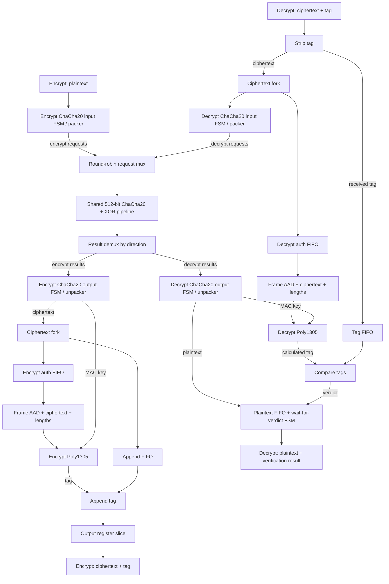

# ChaCha20-Poly1305 AEAD in Pypeline

This design implements concurrent ChaCha20-Poly1305 encryption and decryption
using **Pypeline HDL** to generate FPGA hardware and run native simulation. 

<div align="center">
  
</div>

The default targets Artix-7 at **80 MHz**, with a **256-bit packet
datapath**, one shared ChaCha20 pipeline, and a private pipelined Poly1305 MAC
per direction. Poly1305 processes two 16-byte blocks per beat using interleaved
accumulators, `inferred_body` multiplication, and FSM setup/finalization.

Packet streams use valid/ready handshakes, 32 byte-enable bits, and a last-beat
flag. Encryption appends a 16-byte authentication tag; decryption buffers
plaintext until its authentication verdict is available. The supported payload
limit is 2032 bytes, with up to 32 bytes of associated data (AAD).

The default profile is defined in [src/wireguard_env.py](src/wireguard_env.py).
Its [published results](#current-results) appear below.

## Data flow



Requests carry a 512-bit block, key, nonce, and counter; results return to the
requesting direction's output FSM as a MAC-key block or transformed payload.
Arrows show forward data/control; stream ready signals travel in reverse.
AAD enters each framing block separately. The input/output FSMs and width
converters are private to each direction; only the ChaCha20 pipeline is shared.

The graph follows the current [encrypt](src/chacha20poly1305/encrypt_dataflow_core.py)
and [decrypt](src/chacha20poly1305/decrypt_dataflow_core.py) wiring and the
[shared ChaCha20 service](src/chacha20/chacha20_pipeline_shared.py).

## Source layout

| Location | Purpose |
| --- | --- |
| [build.py](build.py) | Hardware build, HDL export, and simulation entrypoint. |
| [measure.py](measure.py) | Throughput, latency, timing, and area measurement. |
| [bottleneck.py](bottleneck.py) | Block-level performance analysis and reports. |
| [src/wireguard_env.py](src/wireguard_env.py) | Build parameters, default profile, and source imports. |
| [src/aead_types.py](src/aead_types.py) | Stream types, limits, and buffer factories. |
| [src/chacha20/](src/chacha20/) | ChaCha20 arithmetic, stream processing, and shared service. |
| [src/poly1305/](src/poly1305/) | Poly1305 arithmetic, packet processing, and tag verification. |
| [src/prep_auth_data/](src/prep_auth_data/) | Authentication framing. |
| [src/auth_tag/](src/auth_tag/) | Tag packing, extraction, and plaintext verification buffering. |
| [src/chacha20poly1305/](src/chacha20poly1305/) | Encrypt/decrypt wiring, external ports, and testbench support. |
| [src/chacha20poly1305.py](src/chacha20poly1305.py) | Hardware top. |
| [src/chacha20poly1305_tb.py](src/chacha20poly1305_tb.py) | Random/stress native testbench top. |
| [src/chacha20poly1305_syn_tb.py](src/chacha20poly1305_syn_tb.py) | Fixed-vector testbench top. |
| [src/chacha20poly1305_perf_tb.py](src/chacha20poly1305_perf_tb.py) | Native performance testbench top. |
| [src/poly1305_pipelined_syn_tb.py](src/poly1305_pipelined_syn_tb.py), [src/poly1305_paired_tb.py](src/poly1305_paired_tb.py) | Component testbenches. |
| [src/native_arithmetic_models.py](src/native_arithmetic_models.py) | Stateless arithmetic models used by native performance simulation. |
| `generated-files/` | Ignored local build outputs, synthesis cache, and measurements. |

## Setup and options

Run commands from `3.build/pypeline_build`. Use Python 3 with `cryptography`
for reference checks, and a PypelineC checkout with its dependencies installed.
Vivado is needed for hardware synthesis; generated-VHDL simulation uses GHDL
and cocotb, and Verilog export additionally uses Yosys.

```bash
export PYPELINEC=/path/to/PipelineC/src/pypelinec
./build.py --show-config
./measure.py --show-config
```

`build.py` also accepts `pypelinec` on `PATH`. For measurement tooling, set
`PYPELINEC` as above or keep the compiler checkout at `../../../PipelineC`.
`--show-config` prints the resolved settings and output paths without building.

### Design parameters

The table gives defaults for the published profile. The named flags are shared
by `build.py` and `measure.py` unless noted. The parameter column names the
corresponding direct PypelineC `-D` parameter; use named flags in the scripts.

| Option | PypelineC parameter | Values and default |
| --- | --- | --- |
| No design flag; `--enc`, `--dec` (`build.py` only) | `DESIGN` | `shared` (default combined top), `encrypt`, `decrypt`. Standalone directions cannot take sharing flags. |
| `--shared`, `--share-chacha20`, `--share-poly1305`, `--share-none` | `SHARE` | `auto` (default: ChaCha20 only), `both`, `chacha20`, `poly1305`, `none`. `--shared` explicitly shares both services; the two resource flags together do the same. An explicit selection replaces the default set. `--share-none` excludes other sharing flags. |
| `--poly1305` | `POLY1305_IMPL` | `pipelined` (default), `legacy`. Legacy requires 128 bits and inferred multiplication, defaults to ChaCha20 sharing, and cannot share Poly1305. |
| `--data-bitwidth` | `DATA_BITWIDTH` | `256` (default), `128`; selects packet data and byte-enable widths. Legacy defaults to `128`. |
| `--poly1305-mult` | `POLY1305_MULT_IMPL` | `inferred_body` (default: inferred feedback product, Karatsuba elsewhere), `inferred` (wide products), `hybrid` (Karatsuba), `hybrid_square` (Karatsuba plus explicit squares). Legacy defaults to `inferred`. |
| `--poly1305-compute` | `POLY1305_COMPUTE_IMPL` | `fsm` (default), `mcp`; selects pipelined setup/finalization. MCP automatically shares both services unless sharing is explicitly selected. |
| `--poly1305-prologue-cap`, `--poly1305-epilogue-cap` | `POLY1305_PROLOGUE_MAX_LATENCY`, `POLY1305_EPILOGUE_MAX_LATENCY` | Positive FSM latency caps; defaults `44` / `45` at 256 bits, `64` / `64` at 128 bits. |
| `--target-mhz` | `TARGET_MHZ` | Positive integer MHz. Default `80` for 256-bit `inferred_body` and legacy; other profiles default to `85` when sharing both services, otherwise `30`. |

Thanks to **FPGA-House-AG** for the
[Karatsuba DSP multiplier reference](https://github.com/FPGA-House-AG/ChaCha20Poly1305/blob/7e75c097af32429ff2c7979b976fe876efbdb9f3/src_dsp_opt/mul_136_kar.vhd)
that inspired the multiplication choices.

### Build and simulation controls

| Option | Purpose |
| --- | --- |
| `--show-config` | Print resolved profile and paths; available in both scripts. |
| `--sim` | Run a correctness testbench instead of building the hardware. |
| `--native` | Use native simulation; otherwise `--sim` selects cocotb/GHDL. |
| `--comb` | Simulate without automatic pipeline delays; also available in `measure.py` for a rig check without timing/area. |
| `--syn_tb` | Select fixed vectors; default correctness simulation uses random vectors and requires `--native`. |
| `-D NAME=VALUE` | Pass non-profile testbench parameters, such as `TB_STRESS=1`; profile parameters use the named flags above. |
| `--perf` | Run the combined performance testbench; implies `--sim --native`. Prefer `measure.py` for reports. |
| `--verilog` | Export the hardware top to Verilog; cannot combine with simulation. |
| `-j N`, `--jobs N` | Limit concurrent synthesis jobs; positive integer, available in both scripts. |
| `--continue` | Preserve the build output directory; required to reuse a nonempty custom directory. |
| `--rebuild` | Force a hardware build; available in both scripts. |
| `--out-dir DIR` | Select a hardware output directory; pass the same directory to measurement or pipelined native simulation. Available in both scripts. |
| `--syn-cache DIR` | Select the shared synthesis store; default `generated-files/syn_cache`, or `none` to disable. Available in both scripts. |

PypelineC reuses unchanged builds automatically. Its latency memory and shared
synthesis cache avoid repeating matching pipeline searches and syntheses.
Ordinary measurement therefore re-simulates existing hardware without synthesis
when its sources, compiler, and settings match; changed inputs may need a build.

### Measurement controls

| Option | Purpose / default |
| --- | --- |
| `--label NAME` | Local run under `generated-files/measurements/`; defaults to a profile-derived name. An absolute path selects another directory. |
| `--sizes N,N,...` | Payload sizes in bytes; default `1420,1920`, maximum `2032`. |
| `--packets N` | Back-to-back packets per size/direction; default `4`. |
| `--dirs {both,enc,dec}` | Traffic directions; default `both`. This changes stimulus, not the hardware profile. |
| `--peak-bytes N` | Add a long-packet phase; default `0` (disabled). |
| `--seed N` | Payload RNG seed; default `8439`. |
| `--taps FILTER` | Internal probes; default `all`. Accepts block/direction prefixes or exact names; `--taps ''` keeps boundary measurements only. |
| `--steady-trim N` | Exclude N warm-up and N drain packets from completion-rate measurement; default no trimming. |
| `--require-parity` | Check the 1420/1920-byte throughput goal, direction parity, and interval stability; needs at least four packets per size and a pipelined run. |
| `--reuse-syn` | Skip the hardware build step; requires matching, current hardware artifacts. Mutually exclusive with `--rebuild`. |
| `--parse-only` | Regenerate reports from the selected run's existing outputs without building or simulating. |
| `--update-readme` | Publish a validated result matching the default profile into this README. |
| `--save-evidence` | Package build evidence with the local measurement. |
| `--check-record DIR` | Check a saved record and its retained evidence without rewriting it. |
| `--area-report LOG_OR_DIR` | Print utilization; `--per-module` adds module reports and `--json` selects JSON. |
| `--no-per-module-area` | Skip per-module area parsing during measurement. |
| `--audit-mcps DIR` | Inspect emitted MCP arithmetic; `--audit-directions` selects `encrypt`, `decrypt`, or `encrypt,decrypt` (default). |
| `--selftest` | Check measurement/report tooling without synthesis; also supported by `bottleneck.py`. |

Use `./build.py --help` and `./measure.py --help` for the full CLI reference.

## Simulation

Both correctness testbenches check against an independent RFC 8439 reference
using Python's `cryptography` package. They cover packet boundaries and
partial words; decryption also checks a corrupted tag. A run passes only when
it exits zero. Random runs print their seed for reproducibility.

| Testbench / mode | Command | Prerequisite / use |
| --- | --- | --- |
| Random, native combinational | `./build.py --sim --comb --native` | Quick functional check; no synthesis. |
| Fixed vectors, native combinational | `./build.py --sim --syn_tb --comb --native` | Fixed-vector functional check; no synthesis. |
| Stress, native combinational | `./build.py --sim --comb --native -D TB_STRESS=1` | Directed lengths, input gaps, output stalls, and tampered-tag recovery. |
| Random, native pipelined | `./build.py --sim --native` | Build hardware first; simulates its actual latencies and schedules. |
| Fixed vectors, native pipelined | `./build.py --sim --syn_tb --native` | Build hardware first; fixed-vector check of that build. |
| Fixed vectors, generated VHDL | `./build.py --sim --syn_tb` | GHDL/cocotb check before final Verilog export; includes synthesis. |

Build the default hardware with `./build.py` before pipelined native simulation.
A missing or stale build is rejected. Add `-D TB_STRESS=1` to the native random
pipelined command to exercise backpressure with the built schedules.

Random/stress testbenches are native-only. Fixed-vector testbenches support
both simulators; adding `--comb` to their generated-VHDL command skips automatic
pipelining. Native checks are the ordinary development workflow.

## Measuring QoR

### Throughput measurement

```bash
./measure.py --label throughput-check
./measure.py --label final-curve --sizes 16,64,256,1024,1420,1920
```

The first command measures four packets at each of 1420 and 1920 bytes, with
concurrent encrypt/decrypt traffic and internal probes enabled. The second
collects the full payload-size curve. Each command builds only what is needed,
then runs native performance simulation on the matching hardware. Every
packet is checked against the reference model.

Four completions give three packet-completion intervals. Increase packet count
only when those intervals are inconsistent; the parity check allows a 5%
spread. Cold first-packet latency is reported separately from throughput.
Changing payload sizes, packet counts, or seeds only requires simulation.

### What is measured

| Metric | Meaning |
| --- | --- |
| Synthesis fmax | Timing estimate from the real external-port hardware build; routed timing is not measured. |
| Area | Hardware-top LUT, FF, DSP48, and BRAM utilization from Vivado. |
| Sustained B/cycle | Payload bytes divided by mean packet-completion period, excluding cold first-packet latency. |
| Gb/s | Sustained B/cycle × clock MHz × 0.008; local reports include target-clock and fmax rates. |
| Packet period | Mean cycles between packet completions. |
| Cold first output | Cycles from the first packet's input start to its first output. |
| Median total latency | Median cycles from each packet's input start to its final output. |
| Block stalls and service | Internal handshake, FSM, buffer, and arbitration measurements used to locate bottlenecks. |

### Finding a bottleneck

```bash
./measure.py --label bottleneck-check --sizes 1920 --packets 4 --dirs both --taps all
./bottleneck.py generated-files/measurements/bottleneck-check/results.json
```

Read `summary.md` for packet goodput and periods, then `blocks.md` for block
service rates, input starvation, downstream stalls, buffer occupancy, and
shared-resource arbitration. Use the Poly1305 lifecycle breakdown to separate
setup, body, drain, and finalization costs. Check the ChaCha20-to-Poly1305 key
handoff as well as payload edges when investigating packet-boundary stalls.
Use pipelined simulation for performance conclusions; combinational checks
omit the hardware's pipeline delays.

### Measurement outputs

Outputs live under `generated-files/measurements/<label>/` and are ignored by Git.

| File | Contents |
| --- | --- |
| `summary.md`, `summary.csv` | Detailed throughput and latency by payload size/direction. |
| `blocks.md`, `blocks.csv` | Block-level service, stalls, and bottleneck analysis. |
| `results.json` | Complete configuration, provenance, timing, area, and validation record. |
| `taps.csv`, `perf_raw.json` | Internal counters and raw simulation results. |
| `pypelinec.log` | Build/simulation progress and diagnostics. |

### Current results

These are the published measurements for the default profile. Timing and area
come from the external-port hardware top; routed timing has not been measured.
Finite-burst completion rates can retain some startup effects.

<!-- MEASURED-RESULTS:BEGIN -->

_Measured sources: wireguard-fpga `7283e9ffd0c5` (with local changes); PypelineC `dd212e9453ea` (frozen source snapshot `1e54c6517f5c`); Vivado 2019.2. Full provenance and raw artifacts are retained in local measurement outputs._

| Target clock | Synthesis fmax | LUT | FF | DSP48 | BRAM tiles |
| ---: | ---: | ---: | ---: | ---: | ---: |
| 80 MHz | 81.32 MHz | 81,489 | 67,232 | 332 | 26.5 |

Native pipelined simulation; directions: encrypt, decrypt; 4 packets per size/direction; seed 8439. Throughput uses packet-completion intervals.

| Payload bytes | Direction | Sustained B/cycle | Packet period (cycles) | Gb/s @80 MHz | Cold first output (cycles) | Median total latency (cycles) |
| ---: | --- | ---: | ---: | ---: | ---: | ---: |
| 16 | encrypt | 0.333 | 48.0 | 0.213 | 134 | 204.5 |
| 16 | decrypt | 0.333 | 48.0 | 0.213 | 139 | 206.0 |
| 64 | encrypt | 1.333 | 48.0 | 0.853 | 31 | 203.5 |
| 64 | decrypt | 1.032 | 62.0 | 0.661 | 140 | 225.5 |
| 256 | encrypt | 5.333 | 48.0 | 3.413 | 31 | 200.0 |
| 256 | decrypt | 5.333 | 48.0 | 3.413 | 146 | 207.0 |
| 1024 | encrypt | 21.333 | 48.0 | 13.653 | 31 | 183.0 |
| 1024 | decrypt | 21.333 | 48.0 | 13.653 | 170 | 214.0 |
| 1420 | encrypt | 28.784 | 49.3 | 18.422 | 31 | 183.5 |
| 1420 | decrypt | 28.400 | 50.0 | 18.176 | 183 | 229.0 |
| 1920 | encrypt | 30.000 | 64.0 | 19.200 | 31 | 198.0 |
| 1920 | decrypt | 29.845 | 64.3 | 19.101 | 198 | 258.0 |

<!-- MEASURED-RESULTS:END -->

<!-- BLOCK-RESULTS:BEGIN -->

Detailed per-block service/stall, shared arbitration and lifecycle measurements
are generated locally as `blocks.md` in the measurement directory.
Raw measurement artifacts are not included in the repository.

<!-- BLOCK-RESULTS:END -->

To refresh this table from a validated default-profile run:

```bash
./measure.py --label final-curve --sizes 16,64,256,1024,1420,1920 --update-readme
```

Publication rejects unvalidated or non-default measurements. Keep full evidence
locally; [Poly1305 component notes](src/poly1305/throughput.md) hold design
rationale and historical measurements.

## Building VHDL and Verilog

Build the default hardware and inspect its output location:

```bash
./build.py
./build.py --show-config
```

PypelineC writes the generated VHDL and its `vhdl_files.txt` source list under
the reported output directory. The default top is
`chacha20poly1305_encrypt_decrypt_shared`.

For final Verilog export, first run the fixed-vector generated-HDL check:

```bash
./build.py --sim --syn_tb
./build.py --verilog
```

Run the export only after the check succeeds. The Verilog conversion uses
GHDL and Yosys and retains the hardware top name.

## Comparison with the earlier PipelineC design

The [earlier PipelineC sources](../pipelinec_build/src/) implement the same
AEAD operation. This Pypeline design corrects their Poly1305 arithmetic and
ciphertext-length handling, so reference tags and output lengths can differ.

Pypeline uses function calls to instantiate hardware and interfaces to connect
forward data and reverse handshakes. Per-instance C macros become ordinary
function instances; external hardware ports are kept separate from testbenches.

## Appendix: baseline results

The recorded starting point used a 128-bit datapath, legacy Poly1305 with a
six-cycle body loop, and shared ChaCha20 at 80 MHz. Native pipelined simulation
ran concurrent encrypt/decrypt traffic, four packets per size/direction, with
seed 8439. All 48 reference checks passed.

| Payload bytes | Encrypt Gb/s @80 MHz | Decrypt Gb/s @80 MHz |
| ---: | ---: | ---: |
| 16 | 0.330 | 0.258 |
| 64 | 0.836 | 0.710 |
| 256 | 1.354 | 1.267 |
| 1024 | 1.567 | 1.167 |
| 1420 | 1.607 | 1.060 |
| 1920 | 1.620 | 1.181 |

Synthesis met the 80 MHz goal and reported 31,192 LUT, 16,049 FF, 420 DSP,
and 11 BRAM tiles. This area came from a synthesized performance testbench,
whose constant inputs can remove hardware, and is not directly comparable
with the current external-port hardware-top area.

Recorded sources: wireguard-fpga `db70c9753c44` with local changes,
PypelineC `32356330ec7c`, Vivado 2019.2. These are retained historical results,
not a new measurement of the baseline.
