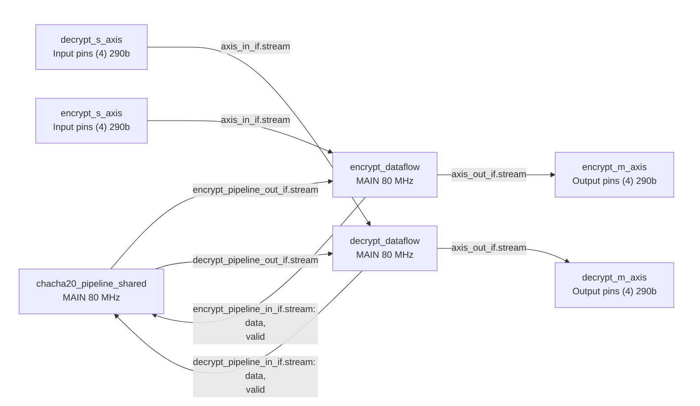
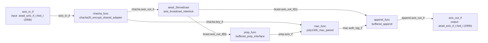

# ChaCha20-Poly1305 AEAD in Pypeline

This design implements concurrent ChaCha20-Poly1305 encryption and decryption
using **Pypeline HDL** to generate FPGA hardware and run native simulation. 

<div align="center">
  
</div>

The default targets Artix-7 at **80 MHz**, with a **256-bit packet
datapath**, one shared ChaCha20 pipeline, and a private pipelined Poly1305 MAC
per direction. Poly1305 processes two 16-byte blocks per beat using
[paired, interleaved accumulators](src/poly1305/poly1305_design.md#breaking-the-serial-chain), and experimental Pypeline HDL
[AUTO_FSM based initialization/finalization state machines](src/poly1305/poly1305_design.md#auto_fsm-versus-auto_mcp).
Current throughput targets use 1420- and 1920-byte payloads. For smaller
packets, the FSM latency caps could be derived from the required throughput
at a chosen payload size.

Packet streams use valid/ready handshakes, 32 byte-enable bits, and a last-beat
flag. Encryption appends a 16-byte authentication tag; decryption buffers
plaintext until its authentication verdict is available. The supported payload
limit is 2032 bytes, with up to 32 bytes of associated data (AAD).

The default profile is defined in [src/wireguard_env.py](src/wireguard_env.py).
Its [published results](#current-results) appear below.

## Data flow

Each diagram below is one level of the design's hierarchy, as the build's
[`diagram.html`](0.doc/diagram.html) draws it ([Building VHDL and Verilog](#building-vhdl-and-verilog)):
the forward data between the blocks a function calls, each wire named as the
code names it. Stream ready signals travel in reverse and are not drawn, nor
are the key, nonce and AAD sideband inputs; operators and registers form logic
blocks, and a dashed edge passes through a `Feedback` variable. To refresh one,
open the page at that view and use **copy as Mermaid**.

### Top level



`encrypt_dataflow` and `decrypt_dataflow` each handle one direction. Both send
ChaCha20 work to the one `chacha20_pipeline_shared` MAIN over global wires and
take its results back. Each direction's AXIS pins form one stream port in and
one out.

### Encrypt



In [encrypt_dataflow](src/chacha20poly1305/encrypt_dataflow.py),
[ChaCha](src/chacha20/chacha20_design.md#packet-streams-and-the-poly1305-key)
supplies ciphertext (`chacha.axis_out_if`) and a separate per-packet Poly1305 key
(`chacha.key_if`). `aead_2broadcast` forks the ciphertext: the first
fork is framed with the AAD, padding and lengths by `prep_func` and
authenticated by `mac_func`
([Poly1305 design](src/poly1305/poly1305_design.md#current-design)); the other
keeps the ciphertext unpadded, and `append_func` packs the tag (`mac.auth_tag_if`) after it. With pipelined MACs,
`append_func` also includes the append FIFO and output slice.

### Decrypt

```mermaid
flowchart LR
    n2["aead_2broadcast<br>axis_broadcast_interlock"]
    n3["chacha_func<br>chacha20_decrypt_shared_adapter"]
    n4["compare_func<br>buffered_compare"]
    n5["mac_func<br>poly1305_mac_paired"]
    n6["prep_func<br>buffered_prep"]
    n7["stripping_func<br>strip_auth_tag_wide"]
    n8["verify_func<br>wait_to_verify"]
    subgraph inputs[" "]
        n0["axis_in_if<br>input  aead_axis_if_t.fwd_t (290b)"]
    end
    style inputs fill:none,stroke:none
    subgraph outputs[" "]
        n1["axis_out_if<br>output  aead_axis_if_t.fwd_t (290b)"]
    end
    style outputs fill:none,stroke:none
    n0 -->|"axis_in_if"| n7
    n2 -->|"bcast.axis_out_if[1]"| n3
    n2 -->|"bcast.axis_out_if[0]"| n6
    n3 -->|"chacha.key_if"| n5
    n3 -->|"chacha.axis_out_if"| n8
    n4 -->|"compare.tags_match_if"| n8
    n5 -->|"mac.auth_tag_if"| n4
    n6 -->|"prep.axis_if"| n5
    n7 -->|"strip.auth_tag_out_if"| n4
    n7 -->|"strip.axis_out_if"| n2
    n8 -->|"verified.axis_out_if"| n1
    n8 ~~~ n1
```



In [decrypt_dataflow](src/chacha20poly1305/decrypt_dataflow.py),
`stripping_func` separates the received tag (`strip.auth_tag_out_if`) from the
ciphertext, which `aead_2broadcast` forks to authentication and decryption.
[ChaCha](src/chacha20/chacha20_design.md) supplies plaintext and the per-packet
Poly1305 key; `prep_func` and
`mac_func` calculate the tag. Both tag streams preserve packet order, and
`compare_func` compares one pair per verdict (`compare.tags_match_if`).
`verify_func` releases the plaintext after the verdict, holding it on
`is_verified_out` for every valid beat, including packets whose authentication
failed.

### One level down

The ChaCha20 and Poly1305 blocks continue in their design documents, each
section built around the same kind of diagram:

- [ChaCha20 design](src/chacha20/chacha20_design.md): the block function and
  its pipeline, the per-packet FSM inside `chacha_func` that sends the
  Poly1305 key, and the shared `chacha20_pipeline_shared` MAIN of the top
  level with its arbiter and result demux.
- [Poly1305 design](src/poly1305/poly1305_design.md): `mac_func`
  (`poly1305_mac_paired`) and its initialization, body and finalization
  stages, down to the two pipelines that process each pair of blocks.

## Source layout

| Location | Purpose |
| --- | --- |
| [build.py](build.py) | Hardware build, HDL export, and simulation entrypoint. |
| [measure.py](measure.py) | Throughput, latency, timing, area, and bottleneck analysis; [functional coverage](#functional-coverage) of the random testbenches. |
| [src/wireguard_env.py](src/wireguard_env.py) | Build parameters, default profile, and source imports. |
| [src/aead_types.py](src/aead_types.py) | Stream types, limits, and buffer factories. |
| [src/chacha20/](src/chacha20/) | ChaCha20 arithmetic and stream processing; [pipeline and sharing design](src/chacha20/chacha20_design.md). |
| [src/poly1305/](src/poly1305/) | Poly1305 arithmetic and packet processing; [architecture and throughput](src/poly1305/poly1305_design.md). |
| [src/prep_auth_data/](src/prep_auth_data/) | Authentication framing. |
| [src/auth_tag/](src/auth_tag/) | Tag append/strip for both widths and decrypt verification buffering. |
| [src/chacha20poly1305/](src/chacha20poly1305/) | Encrypt/decrypt dataflows and structured ports, testbench support, and the [functional-coverage goals](src/chacha20poly1305/func_coverage_goals.py). |
| [src/chacha20poly1305.py](src/chacha20poly1305.py) | Hardware top and flat external I/O. |
| [src/chacha20poly1305_tb.py](src/chacha20poly1305_tb.py) | Native testbench top for random/stress checks and performance measurement. |
| [src/chacha20poly1305_syn_tb.py](src/chacha20poly1305_syn_tb.py) | Fixed-vector testbench top. |
| [src/poly1305/mac_components_tb.py](src/poly1305/mac_components_tb.py), [src/poly1305/paired_path_tb.py](src/poly1305/paired_path_tb.py) | Poly1305 component and paired-path testbenches. |
| [soc/](soc/) | The SoC's gzip'd Verilog: the shared core `top.filelist` uses, and the standalone encrypt and decrypt cores for the block benches. |
| [latency_hints/](latency_hints/) | Kept pipeline depths (`latency_profile.json`) per profile, for `--latency-hints`. |
| [pipelinec.ref](pipelinec.ref) | Oldest PipelineC commit this design works with. |
| `generated-files/` | Ignored local build outputs, synthesis cache, and measurements. |

## Setup and options

Run commands from `3.build/pypeline_build`. Use Python 3 with `cryptography`
for reference checks, and a PypelineC checkout with its dependencies installed.
Vivado is needed for hardware synthesis; 2019.2, 2026.1 and 2026.2 work.
PipelineC runs `vivado` from `PATH`, else from `$XILINX_VIVADO`, else from its
built-in default install path. Generated-VHDL simulation uses GHDL and cocotb,
and Verilog export additionally uses Yosys.

```bash
export PYPELINEC=/path/to/PipelineC/src/pypelinec
./build.py --show-config
./measure.py --show-config
```

`build.py` also accepts `pypelinec` on `PATH`. For measurement tooling, set
`PYPELINEC` as above or keep the compiler checkout at `../../../PipelineC`.
[pipelinec.ref](pipelinec.ref) names the oldest PipelineC commit known to
work. That commit or any newer one should work, and the latest is preferred.
CI lints with that commit, and `build.py` warns when the checkout predates it.
`--show-config` prints the resolved settings and output paths without building.

For a test campaign or a long build, clone the latest PipelineC fresh and run
every step from that clone. Your own checkout can then change meanwhile without
changing the generated VHDL, so the campaign's later builds and simulations
reuse its synthesis cache entries:

```bash
clone=$PWD/generated-files/pipelinec-$(date +%Y%m%d-%H%M)
git clone -q https://github.com/JulianKemmerer/PipelineC "$clone"  # or a local checkout, for unpushed commits
export PYPELINEC=$clone/src/pypelinec
```

The clone brings PipelineC's committed `cache/` of per-operator delay and area
measurements, which builds use by default. Leave `PYPELINEC_CACHE_DIR` unset in
normal use. A CI runner may set it, after copying the clone's `cache/` there so
it does not start empty. The shared `--syn-cache` holds module and whole-design
syntheses instead.

### Design parameters

The table gives defaults for the published profile. The named flags are shared
by `build.py` and `measure.py` unless noted. The parameter column names the
corresponding direct PypelineC `-D` parameter; use named flags in the scripts.

| Option | PypelineC parameter | Values and default |
| --- | --- | --- |
| No design flag; `--enc`, `--dec` (`build.py` only) | `DESIGN` | `shared` (default combined top), `encrypt`, `decrypt`. Standalone directions cannot take sharing flags. |
| `--shared`, `--share-chacha20`, `--share-poly1305`, `--share-none` | `SHARE` | `auto` (default: ChaCha20 only), `both`, `chacha20`, `poly1305`, `none`. `--shared` explicitly shares both resources; the two resource flags together do the same. An explicit selection replaces the default set. `--share-none` excludes other sharing flags. |
| `--poly1305` | `POLY1305_IMPL` | `pipelined` (default), `legacy`. Legacy requires 128 bits and inferred multiplication, defaults to ChaCha20 sharing, and cannot share Poly1305. |
| `--data-bitwidth` | `DATA_BITWIDTH` | `256` (default), `128`; selects packet data and byte-enable widths. Legacy defaults to `128`. |
| `--poly1305-mult` | `POLY1305_MULT_IMPL` | `inferred_body` (default: inferred feedback product, Karatsuba elsewhere), `inferred` (wide products), `hybrid` (Karatsuba), `hybrid_square` (Karatsuba plus explicit squares). Legacy defaults to `inferred`. |
| `--poly1305-compute` | `POLY1305_COMPUTE_IMPL` | `fsm` (default), `mcp`; selects pipelined initialization/finalization ([architecture comparison](src/poly1305/poly1305_design.md#auto_fsm-versus-auto_mcp)). MCP automatically shares both resources unless sharing is explicitly selected. |
| `--poly1305-prologue-cap`, `--poly1305-epilogue-cap` | `POLY1305_PROLOGUE_MAX_LATENCY`, `POLY1305_EPILOGUE_MAX_LATENCY` | Initialization/finalization FSM latency caps; defaults `44` / `45` at 256 bits, `64` / `64` at 128 bits. |
| `--target-mhz` | `TARGET_MHZ` | Positive integer MHz. Default `80` for 256-bit `inferred_body` and legacy; other profiles default to `85` when sharing both resources, otherwise `30`. |
| `--soc` | `DATA_BITWIDTH`, `TARGET_MHZ` | SoC profile: `--data-bitwidth 128 --target-mhz 80`, the DPE stream width and clock. A different explicit value for either is an error. |

Thanks to **FPGA-House-AG** for the
[Karatsuba DSP multiplier reference](https://github.com/FPGA-House-AG/ChaCha20Poly1305/blob/7e75c097af32429ff2c7979b976fe876efbdb9f3/src_dsp_opt/mul_136_kar.vhd)
that inspired the multiplication choices.

### Build and simulation controls

Generated build directories and default measurement labels include the top, Poly1305
architecture, sharing, multiplier, compute implementation, datapath width, target
clock, and both latency caps. The default hardware directory ends in
`-256bit-80mhz-procap44-epicap45`. With `--soc` it ends in
`-128bit-80mhz-procap64-epicap64`. Use `--show-config` to print the full paths.

| Option | Purpose |
| --- | --- |
| `--show-config` | Print resolved profile and paths; available in both scripts. |
| `--sim` | Run a correctness testbench instead of building the hardware. |
| `--native` | Use native simulation; otherwise `--sim` selects cocotb/GHDL. |
| `--comb` | Simulate without automatic pipeline delays; also available in `measure.py` for a rig check without timing/area. |
| `--syn_tb` | Select fixed vectors; default correctness simulation uses random vectors and requires `--native`. |
| `-D NAME=VALUE` | Pass non-profile testbench parameters, such as `TB_STRESS=1`; profile parameters use the named flags above. |
| `--wave FILE` | With `--sim`, write the simulation's [waveform](#waveforms): `.vcd` or `.fst` natively (FST needs GTKWave's `vcd2fst`), or `.vcd`, `.fst` or `.ghw` from GHDL. |
| `--wave-signals PATTERN` | With `--wave` and `--native`, also record the global Wires whose waveform path matches the glob (`pypelinec --wave_signals`), e.g. `'encrypt_dataflow/*'`; repeatable. |
| `--perf` | Set `PERF=1` on the native testbench; implies `--sim --native` and requires the combined design. Prefer `measure.py` for reports. |
| `--verilog` | Export the hardware top to Verilog, FIFOs as memories (`memory -nomap`); cannot combine with simulation. |
| `-j N`, `--jobs N` | Limit concurrent synthesis jobs; positive integer, available in both scripts. |
| `--continue` | Preserve the build output directory; required to reuse a nonempty custom directory. |
| `--rebuild` | Force a hardware build; available in both scripts. |
| `--out-dir DIR` | Select a hardware output directory; pass the same directory to measurement or pipelined native simulation. Available in both scripts. |
| `--syn-cache DIR` | Select the shared synthesis store; default `generated-files/syn_cache`, or `none` to disable. Available in both scripts. |
| `--latency-hints FILE` | Start a hardware build with depths from an earlier build's `latency_profile.json` (`pypelinec --latency_hints`). Repeatable. By default, `build.py` looks in [latency_hints/](latency_hints/) for the profile's generated hardware directory name plus `.json`, including with a custom `--out-dir`. Use `none` to skip hints. |

PypelineC reuses unchanged builds automatically. Its latency memory and shared
synthesis cache avoid repeating matching pipeline searches and syntheses.
Ordinary measurement therefore re-simulates existing hardware without synthesis
when its sources, compiler, and settings match; changed inputs may need a build.
The cache matches the exact generated VHDL, which records Python source line
numbers. An edit that shifts lines in a design file therefore also misses for
the modules after it in that file and for the syntheses that read the shared
VHDL packages; a newer PipelineC can change the generated VHDL too.

### Measurement controls

| Option | Purpose / default |
| --- | --- |
| `--label NAME` | Local run under `generated-files/measurements/`; defaults to a profile-derived name. An absolute path selects another directory. |
| `--sizes N,N,...` | Payload sizes in bytes; default `1420,1920`, maximum `2032`. |
| `--packets N` | Back-to-back packets per size/direction; default `4`. |
| `--dirs {both,enc,dec}` | Traffic directions; default `both`. This changes stimulus, not the hardware profile. |
| `--peak-bytes N` | Add a long-packet phase; default `0` (disabled). |
| `--seed N` | Payload RNG seed; default `8439`. With `--coverage`, the seed of the random modes (`TB_SEED`). |
| `--taps FILTER` | Internal probes; default `all`. Accepts block/direction prefixes or exact names; `--taps ''` keeps boundary measurements only. |
| `--steady-trim N` | Exclude N warm-up and N drain packets from completion-rate measurement; default no trimming. |
| `--require-parity` | Check the 1420/1920-byte throughput goal, direction parity, and interval stability; needs at least four packets per size and a pipelined run. |
| `--reuse-syn` | Skip the hardware build step; requires matching, current hardware artifacts. Mutually exclusive with `--rebuild`. |
| `--bottleneck-report RESULTS_JSON` | Print block analysis of a saved record without building, simulating, or changing it. |
| `--coverage MODES` | [Functional coverage](#functional-coverage) of the comma-separated modes `default`, `stress`, `closure`, instead of performance. With `--comb` nothing is built; otherwise it simulates the already-built hardware (build it first). Writes `coverage.md` and `coverage.json`; exits nonzero on a lost corner. |
| `--coverage-report RUN` | Print a saved `--coverage` run (its label or directory) without simulating. |
| `--coverage-diff A B` | Compare two saved `--coverage` runs: corners gained or lost, and bins redefined by a different build. |
| `--parse-only` | Regenerate reports from the selected run's existing outputs without building or simulating; with `--coverage`, re-judge the named modes from their saved raw facts. |
| `--update-readme` | Publish a validated result matching the default profile into this README. |
| `--save-evidence` | Package build evidence with the local measurement. |
| `--check-record DIR` | Check a saved record and its retained evidence without rewriting it. |
| `--area-report LOG_OR_DIR` | Print utilization; `--per-module` adds module reports and `--json` selects JSON. |
| `--no-per-module-area` | Skip per-module area parsing during measurement. |
| `--audit-mcps DIR` | Inspect emitted MCP arithmetic; `--audit-directions` selects `encrypt`, `decrypt`, or `encrypt,decrypt` (default). |
| `--selftest` | Check measurement/report tooling without synthesis; includes block analysis, saved-report and coverage checks. |

Use `./build.py --help` and `./measure.py --help` for the full CLI reference.

## Simulation

Both correctness testbenches check against an independent RFC 8439 reference
using Python's `cryptography` package. They cover packet boundaries and
partial words; decryption also checks a corrupted tag. A run passes only when
it exits zero. Random runs print their seed for reproducibility.

| Testbench / mode | Command | Prerequisite / use |
| --- | --- | --- |
| Random, native combinational | `./build.py --sim --comb --native` | Quick functional check; no synthesis. |
| Fixed vectors, native combinational | `./build.py --sim --syn_tb --comb --native` | Fixed-vector functional check; no synthesis. |
| Stress, native combinational | `./build.py --sim --comb --native -D TB_STRESS=1` | Directed lengths, input gaps, output stalls, and tampered-tag recovery. |
| Random, native pipelined | `./build.py --sim --native` | Build hardware first; simulates its actual latencies and schedules. |
| Functional coverage, native | `./measure.py --coverage default --comb` | Which corners the random runs reach, against the waiver lists; see [functional coverage](#functional-coverage). |
| Fixed vectors, native pipelined | `./build.py --sim --syn_tb --native` | Build hardware first; fixed-vector check of that build. |
| Fixed vectors, generated VHDL | `./build.py --sim --syn_tb` | GHDL/cocotb check before final Verilog export; includes synthesis. |

Build the default hardware with `./build.py` before pipelined native simulation.
A missing or stale build is rejected. Add `-D TB_STRESS=1` to the native random
pipelined command to exercise backpressure with the built schedules.

Testbench parameters (`-D NAME=VALUE`; none change the hardware):

| Parameter | Default | Purpose |
| --- | --- | --- |
| `TB_STRESS` | `0` | 20 directed lengths, input gaps, output stalls, and a mid-run tampered tag. |
| `TB_SEED` | `8439` | Seed of the random lengths and payloads. |
| `TB_PACKETS` | `0` | Packets per direction; `0` keeps the mode's count (12, 20 with stress, the plan's with closure). Decrypt adds one tampered packet. |
| `TB_CLOSURE` | `0` | Replace the random lengths with the coverage-closing plan of [func_coverage_goals.py](src/chacha20poly1305/func_coverage_goals.py). |
| `TB_WATCHDOG_CYCLES` | `2000` | Fail a direction that accepts no beat for this many cycles with packets pending. |
| `TB_COVERAGE_JSON` | none | Write the run's raw coverage facts and turn the probe taps on; `measure.py --coverage` sets it. |

The native testbench defaults to random/stress checks (`PERF=0`). Its performance
mode (`PERF=1`, selected by `--perf`) uses coordinated packet-size phases,
continuous input, and always-ready outputs, while still checking every packet.
[perf_tb_common.py](src/chacha20poly1305/perf_tb_common.py) handles phase
coordination and recording.

Fixed-vector testbenches support both simulators; adding `--comb` to their
generated-VHDL command skips automatic
pipelining. Native checks are the ordinary development workflow.

### Waveforms

`--wave FILE` records any simulation's waveform, for GTKWave or Surfer:

```bash
./build.py --sim --comb --native --wave enc.vcd --enc
./build.py --sim --syn_tb --comb --native --wave shared.fst --wave-signals '*dataflow/*'
```

A native waveform shows the hardware top's flat ports, `encrypt_s_axis_tdata`,
`encrypt_s_axis_tkeep`, `_tlast`, `_tvalid`, `_tready`, the `encrypt_m_axis_*` side,
`encrypt_key`, `_nonce`, `_aad` and `_aad_len`, and their `decrypt_*` counterparts with
`decrypt_m_verified`, packed by the [hardware top](src/chacha20poly1305.py) with
lane 0 in the low byte. The [encrypt dataflow](src/chacha20poly1305/encrypt_dataflow.py)
and [decrypt dataflow](src/chacha20poly1305/decrypt_dataflow.py) define these waveform
names alongside the structured wires that the testbenches drive. Every
stream probe appears too, as `<direction>/<block>/.../valid` and `ready`, and each state
probe as its state's name. `--wave-signals` adds the structured port Wires themselves. A
generated-VHDL run (no `--native`) has GHDL write the file instead, with the design's VHDL
signals; use `.ghw` there, since GHDL's VCD and FST skip records and arrays.

### Functional coverage

A random run reports only pass or fail. A repeat on an improved design, or on
the same design built differently, can pass while reaching other corners, and a
different seed or packet count does the same. `measure.py --coverage` records
which corners the random testbenches reached, compares them with the goals in
[func_coverage_goals.py](src/chacha20poly1305/func_coverage_goals.py), and exits
nonzero when a corner a mode used to reach is lost.

```bash
./measure.py --coverage default,stress,closure --comb --label cov-comb        # no build; 2 MAC lanes
./measure.py --coverage default,stress,closure --label cov-pipe               # the built hardware
./measure.py --coverage-diff cov-comb cov-pipe                                # what the build changed
./measure.py --coverage default,stress,closure --label cov-comb --parse-only  # re-judge saved runs
```

Each mode simulates once through `build.py --sim --native` and leaves
`coverage-<mode>.json` (its raw facts, with the run's exit code and revisions),
`coverage.json` and `coverage.md` under `generated-files/measurements/<label>/`
(default label starts with `coverage-comb-shared` or `coverage-pipe-shared`
and includes the full profile). `--parse-only`
re-judges the modes it names from their raw files, and `coverage.json` then
holds those modes. A native run takes about 2 s per simulated cycle: `default`
is 217 cycles on a comb build (about ten minutes) and `closure` 458 (about
twenty); `stress` runs longer, so budget an hour or more. Turning the probe taps
on costs under 1% of the simulation time.

| Mode | Stimulus |
| --- | --- |
| `default` | The random run: 12 packets per direction, plus a tampered one for decrypt. |
| `stress` | `-D TB_STRESS=1`: directed lengths up to 2032 bytes, input gaps, output stalls, and a mid-run tamper. |
| `closure` | `-D TB_CLOSURE=1`: 36 packets from a greedy set cover, so every length-dependent bin below is reached for both beat widths and up to eight MAC lanes. All but the three the long length classes need (1024, 1091 and 2032 bytes) are at most 198 bytes. |

**What is binned.** Functional bins must be hit; timing bins are reported.

- *Stimulus, per direction* (functional): packet length class, the bytes in the
  final beat and final Poly1305 word, how the tag meets the final beat (append
  and strip paths), authentication block parity and the MAC lane that takes the
  final pair (256 bits), the final ChaCha20 block, the AAD class, and the
  verdict and its sequence.
- *Design* (functional): every declared state of every FSM, whether each edge
  transferred, and each arbitration requester, from the probe taps of PipelineC's
  `stream_perf_probe`. The probes are simulation-only and add no hardware.
- *Cover probes* (`cover.*`): one event per packet for the corners above. Where
  the stimulus predicts an event count, the probe must report exactly it, so a
  stale model or a probe that stops firing fails the run.
- *Timing*: packet timing (first packet, back to back, after a gap, after a
  drain, input gaps, output stalls, input held back), edge stalls, FIFO
  high-water marks, arbitration blocking and contention, and races between
  stages. These depend on the design's timing as well as the stimulus, so comb
  and pipelined runs can differ. A mode requires only the few its stimulus
  guarantees: input gaps and output stalls under `stress`.

**The baseline is the waiver list.** [func_coverage_goals.py](src/chacha20poly1305/func_coverage_goals.py)
names each mode's empty bins with the reason, and the holes no mode can close
(`PERMANENT`). A run fails on an empty bin that is not listed (a lost corner),
on a listed bin that is hit (a stale waiver to delete), on a required timing
bin that stays empty, and on a model mismatch. With all three modes, the suite
view also fails on a hole no mode closes. Only the default 256-bit shared build
has lists; other profiles, such as `--soc`, are reported without gating.

**What it does not cover.** Every packet carries the same key, nonce and 29-byte
AAD, and decrypt tampers only `tag[0]`, so the AAD classes and single-pair
packets stay permanent holes. Outputs are always ready except under `stress`,
whose patterns are unchanged, and no run restarts after a full drain (a timing
bin, so it is reported, not waived). The fixed-vector testbenches are not
simulated here; their lengths are listed in the suite view only.

**Builds differ.** The MAC has body latency + 2 accumulator lanes: `--comb` has
2, the built default 5, and each lane is its own bin. A pipelined run therefore
reaches corners a comb run cannot, and the diff of the two shows them as
redefined bins. A build with another latency gets another lane count: its new
lanes are unwaived holes until a mode reaches them (`closure` covers up to eight).
Packet timing also differs between builds, which is why it is reported, not gated.

## Measuring QoR

### Throughput measurement

```bash
./measure.py --label throughput-check
./measure.py --label final-curve --sizes 16,64,256,1024,1420,1920
```

The first command measures four packets at each of 1420 and 1920 bytes, with
concurrent encrypt/decrypt traffic and internal probes enabled. The second
collects the full payload-size curve. Each command builds only what is needed,
then runs native performance simulation on the matching hardware. Every
packet is checked against the reference model.

Four completions give three packet-completion intervals. Increase packet count
only when those intervals are inconsistent; the parity check allows a 5%
spread. Cold first-packet latency is reported separately from throughput.
Changing payload sizes, packet counts, or seeds only requires simulation.

### What is measured

| Metric | Meaning |
| --- | --- |
| Synthesis fmax | Timing estimate from the real external-port hardware build; routed timing is not measured. |
| Area | Hardware-top LUT, FF, DSP48, and BRAM utilization from Vivado. |
| Sustained B/cycle | Payload bytes divided by mean packet-completion period, excluding cold first-packet latency. |
| Gb/s | Sustained B/cycle × clock MHz × 0.008; local reports include target-clock and fmax rates. |
| Packet period | Mean cycles between packet completions. |
| Cold first output | Cycles from the first packet's input start to its first output. |
| Median total latency | Median cycles from each packet's input start to its final output. |
| Block rates and stalls | Internal handshake, FSM, buffer, and arbitration measurements used to locate bottlenecks. |

### Finding a bottleneck

```bash
./measure.py --label bottleneck-check --sizes 1920 --packets 4 --dirs both --taps all
```

Normal measurement writes the bottleneck analysis to `blocks.md`. To print it
again from a saved record:

```bash
./measure.py --bottleneck-report generated-files/measurements/bottleneck-check/results.json
```

Read `summary.md` for payload throughput and periods, then `blocks.md` for block
processing rates, input starvation, downstream stalls, buffer occupancy, and
shared-resource arbitration. Use the Poly1305 lifecycle breakdown to separate
initialization, body, drain, and finalization costs. Check the ChaCha20-to-Poly1305 key
handoff as well as payload edges when investigating packet-boundary stalls.
Use pipelined simulation for performance conclusions; combinational checks
omit the hardware's pipeline delays.
[Where the time goes](src/poly1305/poly1305_design.md#where-the-time-goes)
reads the current results this way, stage by stage.

### Measurement outputs

Outputs live under `generated-files/measurements/<label>/` and are ignored by Git.

| File | Contents |
| --- | --- |
| `summary.md`, `summary.csv` | Detailed throughput and latency by payload size/direction. |
| `blocks.md`, `blocks.csv` | Block throughput, stalls, and bottleneck analysis. |
| `results.json` | Complete configuration, provenance, timing, area, and validation record. |
| `taps.csv`, `perf_raw.json` | Internal counters and raw simulation results. |
| `pypelinec.log` | Build/simulation progress and diagnostics. |

### Current results

These are the published measurements for the default profile. Timing and area
come from the external-port hardware top; routed timing has not been measured.
Finite-burst completion rates can retain some startup effects.

<!-- MEASURED-RESULTS:BEGIN -->

_Measured sources: wireguard-fpga `7283e9ffd0c5` (with local changes); PypelineC `dd212e9453ea` (frozen source snapshot `1e54c6517f5c`); Vivado 2019.2. Full provenance and raw artifacts are retained in local measurement outputs._

| Target clock | Synthesis fmax | LUT | FF | DSP48 | BRAM tiles |
| ---: | ---: | ---: | ---: | ---: | ---: |
| 80 MHz | 81.32 MHz | 81,489 | 67,232 | 332 | 26.5 |

Native pipelined simulation; directions: encrypt, decrypt; 4 packets per size/direction; seed 8439. Throughput uses packet-completion intervals.

| Payload bytes | Direction | Sustained B/cycle | Packet period (cycles) | Gb/s @80 MHz | Cold first output (cycles) | Median total latency (cycles) |
| ---: | --- | ---: | ---: | ---: | ---: | ---: |
| 16 | encrypt | 0.333 | 48.0 | 0.213 | 134 | 204.5 |
| 16 | decrypt | 0.333 | 48.0 | 0.213 | 139 | 206.0 |
| 64 | encrypt | 1.333 | 48.0 | 0.853 | 31 | 203.5 |
| 64 | decrypt | 1.032 | 62.0 | 0.661 | 140 | 225.5 |
| 256 | encrypt | 5.333 | 48.0 | 3.413 | 31 | 200.0 |
| 256 | decrypt | 5.333 | 48.0 | 3.413 | 146 | 207.0 |
| 1024 | encrypt | 21.333 | 48.0 | 13.653 | 31 | 183.0 |
| 1024 | decrypt | 21.333 | 48.0 | 13.653 | 170 | 214.0 |
| 1420 | encrypt | 28.784 | 49.3 | 18.422 | 31 | 183.5 |
| 1420 | decrypt | 28.400 | 50.0 | 18.176 | 183 | 229.0 |
| 1920 | encrypt | 30.000 | 64.0 | 19.200 | 31 | 198.0 |
| 1920 | decrypt | 29.845 | 64.3 | 19.101 | 198 | 258.0 |

<!-- MEASURED-RESULTS:END -->

<!-- BLOCK-RESULTS:BEGIN -->

Detailed per-block service/stall, shared arbitration and lifecycle measurements
are generated locally as `blocks.md` in the measurement directory.
Raw measurement artifacts are not included in the repository.

<!-- BLOCK-RESULTS:END -->

To refresh this table from a validated default-profile run:

```bash
./measure.py --label final-curve --sizes 16,64,256,1024,1420,1920 --update-readme
```

Publication rejects unvalidated or non-default measurements. Keep full evidence
locally; [Poly1305 component notes](src/poly1305/poly1305_design.md) explain the
architecture and throughput tradeoffs, and
[which stage limits each packet size](src/poly1305/poly1305_design.md#where-the-time-goes).

## Building VHDL and Verilog

Build the default hardware and inspect its output location:

```bash
./build.py
./build.py --show-config
```

PypelineC writes the generated VHDL and its `vhdl_files.txt` source list under
the reported output directory, with `diagram.html`, a page to browse the
design's hierarchy in (the [data flow](#data-flow) diagrams come from it; a
copy is kept at [`0.doc/diagram.html`](0.doc/diagram.html)). The
default top is `chacha20poly1305_encrypt_decrypt_shared`.

For final Verilog export, first run the fixed-vector generated-HDL check:

```bash
./build.py --sim --syn_tb
./build.py --verilog
```

Run the export only after the check succeeds. The Verilog conversion uses
GHDL and Yosys and retains the hardware top name. `build.py` runs it a second
time with Yosys `memory -nomap`: pypelinec's own conversion maps every FIFO to
flops, which more than doubles the core's LUTs and multiplies its flops by six
in Vivado.

The standalone cores (`--enc`, `--dec`) start every module name of their
Verilog with `enc_` or `dec_`, except the top (`chacha20poly1305_encrypt`,
`chacha20poly1305_decrypt`). Both netlists then go into one design: without
the prefix, the two define the same helper modules, and a simulator or
synthesis tool keeps one of each name or stops.

## Comparison with the earlier PipelineC design

The [earlier PipelineC sources](../pipelinec_build/src/) implement the same
AEAD operation. See the Poly1305 notes for the
[legacy architecture](src/poly1305/poly1305_design.md#legacy-architecture) and
[arithmetic and framing corrections](src/poly1305/poly1305_design.md#corrections-from-the-earlier-pipelinec-implementation).

Pypeline uses function calls to instantiate hardware and interfaces to connect
forward data and reverse handshakes. Per-instance C macros become ordinary
function definitions; external hardware ports are kept separate from testbenches.

## Issues filed upstream

Issues filed upstream from this design, open and closed.

| Tool | Issue | What | Workaround | State |
| --- | --- | --- | --- | --- |
| PipelineC | [PipelineC#396](https://github.com/JulianKemmerer/PipelineC/issues/396) ([#37](https://github.com/chili-chips/wireguard-fpga/issues/37)) | Feature: auto-pipeliner aware of DSP48 boundaries. The Poly1305 coefficient product `(c0·r + c1) mod p` infers 36 DSP48E1 but runs them combinationally. | None needed; 80 MHz is met by more stages. | open |
| PipelineC | [PipelineC#397](https://github.com/JulianKemmerer/PipelineC/issues/397) ([#38](https://github.com/chili-chips/wireguard-fpga/issues/38)) | Feature: faster sweep. The default build takes 1 h 55 min on Vivado 2026.1, 54 min of it in 7 whole-design syntheses of all three MAINs. | Reuse the latency memory and `--syn-cache`, or pass a kept `latency_profile.json` as `--latency-hints`. | open |
| PipelineC | [PipelineC#400](https://github.com/JulianKemmerer/PipelineC/issues/400) ([#59](https://github.com/chili-chips/wireguard-fpga/issues/59)) | Feature: unique module names per top. The standalone encrypt and decrypt netlists share 419 module names, so Verilator needs `-Wno-MODDUP` and keeps one body of each. | `build.py --enc` and `--dec` pass `--module_prefix enc_` and `dec_`. | fixed in 4e7a7ced (`--module_prefix`), closed; the standalone `soc/` cores rebuilt with it 2026-11-23 for the block benches, which no longer need `-Wno-MODDUP` (65.6 MHz on Vivado 2026.2: simulation only, [#59](https://github.com/chili-chips/wireguard-fpga/issues/59)). The SoC uses the shared core, `soc/chacha20poly1305_encrypt_decrypt_shared.v.gz` (2026-11-24). |
| PipelineC | [PipelineC#394](https://github.com/JulianKemmerer/PipelineC/issues/394) | Bug: an empty VHDL record from an untyped namedtuple, which Vivado 2026.1 and GHDL reject; it stopped two 256-bit builds ([appendix](#appendix-vivado-20261-profile-comparison)). | Workaround in PipelineC `5b816e9d`. | fixed (99e5e018) |
| PipelineC | [PipelineC#398](https://github.com/JulianKemmerer/PipelineC/issues/398) ([#42](https://github.com/chili-chips/wireguard-fpga/issues/42)) | Feature: prove the generated HDL equal to the Python source by formal equivalence (LEQ): an unpipelined reference HDL from the same source, a latency-shifted miter, Yosys or SymbiYosys. | Simulation only; our RTL LEQ, `3.build/hw_build.openXC7/run-leq.sh`, is the example. | open |

## Appendix: Vivado 2026.1 profile comparison

The default 256-bit profile next to the 128-bit SoC profile (`--soc`), both
built and measured with Vivado 2026.1 for `xc7a200tffg1156-2` at an 80 MHz
goal. Sizing for the SoC is tracked in
[#40](https://github.com/chili-chips/wireguard-fpga/issues/40).

| | 256-bit (default) | 128-bit (`--soc`) |
| --- | ---: | ---: |
| **Throughput per direction, both directions running** | | |
| 1920-byte packets | 19.20 / 19.10 Gb/s | 9.91 / 9.91 Gb/s |
| 1420-byte packets | 18.42 / 18.18 Gb/s | 9.67 / 9.67 Gb/s |
| 64-byte packets | 0.85 / 0.66 Gb/s | 0.82 / 0.81 Gb/s |
| Packet period at 64 bytes, encrypt / decrypt | 48 / 62 clocks | 50 / 50.3 clocks |
| **Resources** | | |
| LUT | 82,944 (61.6%) | 63,574 (47.2%) |
| FF | 67,171 (25.0%) | 55,982 (20.8%) |
| DSP48E1 | 332 (44.9%) | 230 (31.1%) |
| BRAM tiles | 26.5 (7.3%) | 18.5 (5.1%) |
| **Fmax (synthesis, whole design)** | | |
| Encrypt / decrypt | 81.57 MHz | 81.81 MHz |
| ChaCha20 (shared) | 95.69 MHz | 95.69 MHz |
| **Pipeline** | | |
| ChaCha20 block | 19 stages | 19 stages |
| Poly1305 feedback body | 3 stages, 5 lanes | 4 stages, 6 lanes |
| Poly1305 coefficient | 8 stages | none (one block per clock) |
| Poly1305 init / finalization response | 43 / 46 clocks | 47 / 36 clocks |
| **Wall clock** | | |
| Hardware build | 1 h 55 min, 7 sweep passes | 1 h 17 min, 3 sweep passes |
| of which whole-design synthesis | 54 min (7 runs) | 25 min (4 runs) |
| Throughput measurement (native sim) | 31.6 min | 31.6 min |

Throughput is `encrypt / decrypt` at 80 MHz, from 4 back-to-back packets per
size. The 256-bit build reused per-block results from two earlier attempts
that stopped on PipelineC#394; the 128-bit build started from an empty store.

**Critical paths** (Vivado post-synthesis, 12.5 ns budget):

| Path | 256-bit | 128-bit |
| --- | --- | --- |
| Whole design, worst | 12.29 ns, slack +0.24 ns: Poly1305 init AUTO_FSM (decrypt); 27 levels (22 CARRY4, 1 DSP48) | 12.18 ns, slack +0.28 ns: Poly1305 feedback body; 71 levels (64 CARRY4) |
| Poly1305 feedback body, `A·r^L + c mod p` | 12.18 ns at 3 stages; 71 levels (64 CARRY4); 64 DSP48 | 12.18 ns at 4 stages; same path |
| Poly1305 coefficient, `(c0·r + c1) mod p` | 11.37 ns at 8 stages; 24 levels (19 CARRY4, 2 DSP48); 36 DSP48 | none |

The feedback body's delay is the `uint260_mod_prime` reduction's carry chains,
not its DSP48s. The coefficient product's DSP48s run without their internal
registers ([#37](https://github.com/chili-chips/wireguard-fpga/issues/37)).
Its delay fell with depth: 37.4 ns combinational, 16.7 ns at 4 stages,
11.4 ns at 8.

Sources: wireguard-fpga `27e74cd` (256-bit) and `7643c59` (128-bit), same
design files; PipelineC `5b816e9d` with the PipelineC#394 workaround. Each
profile's pipeline depths are kept in [latency_hints/](latency_hints/).

## Appendix: baseline results

The recorded starting point used a 128-bit datapath, legacy Poly1305 with a
six-cycle body loop, and shared ChaCha20 at 80 MHz. Native pipelined simulation
ran concurrent encrypt/decrypt traffic, four packets per size/direction, with
seed 8439. All 48 reference checks passed.

| Payload bytes | Encrypt Gb/s @80 MHz | Decrypt Gb/s @80 MHz |
| ---: | ---: | ---: |
| 16 | 0.330 | 0.258 |
| 64 | 0.836 | 0.710 |
| 256 | 1.354 | 1.267 |
| 1024 | 1.567 | 1.167 |
| 1420 | 1.607 | 1.060 |
| 1920 | 1.620 | 1.181 |

Synthesis met the 80 MHz goal and reported 31,192 LUT, 16,049 FF, 420 DSP,
and 11 BRAM tiles. This area came from a synthesized performance testbench,
whose constant inputs can remove hardware, and is not directly comparable
with the current external-port hardware-top area.

Recorded sources: wireguard-fpga `db70c9753c44` with local changes,
PypelineC `32356330ec7c`, Vivado 2019.2. These are retained historical results,
not a new measurement of the baseline.
