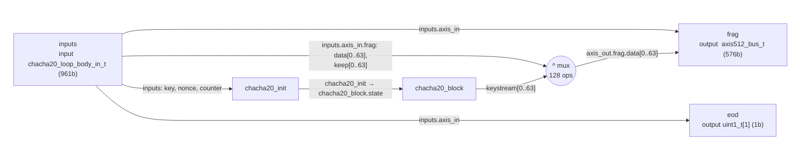
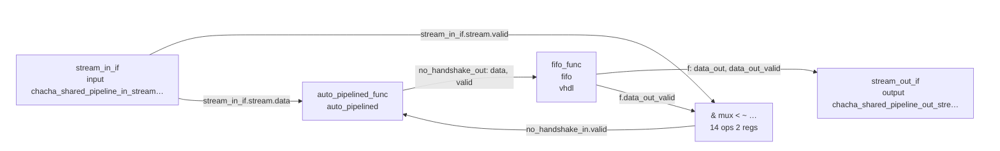
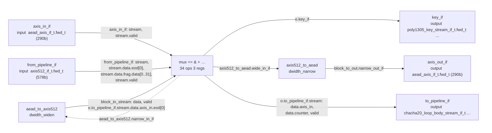
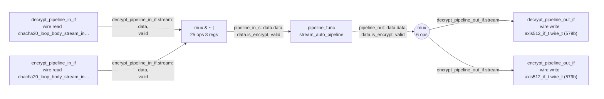
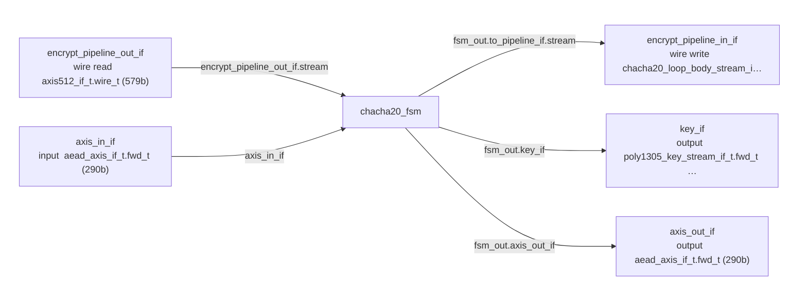

# ChaCha20 design

The default design shares one 512-bit ChaCha20 block pipeline between encrypt
and decrypt. Each direction keeps its own packet counters, input/output FSMs,
and width converters. Both directions use the same arithmetic: XOR with the
keystream encrypts plaintext or decrypts ciphertext.

The build README's [encrypt](../../README.md#encrypt) and
[decrypt](../../README.md#decrypt) charts show where ChaCha20 sits in each
direction: the `chacha_func` block supplies the payload stream and the
per-packet key for the [Poly1305 MAC](../poly1305/poly1305_design.md). The
README also covers [configuration](../../README.md#design-parameters) and
[current measurements](../../README.md#current-results).

The diagrams below are the build's [`diagram.html`](../../0.doc/diagram.html) views of the code, one per
function, read as the README's [data flow](../../README.md#data-flow) section
describes: each wire is named by the variable that carries it, ready signals
are not drawn, and a dashed edge passes through a `Feedback` variable. A
rectangle labelled with operators (`mux & ~ | …`) is the function's own logic,
with its register count; a circle is logic without registers. The sections run
from the arithmetic outwards: the block function, the pipeline around it, the
packet FSM that feeds it, and the sharing between the two directions.

## Block function

`chacha20_loop_body` in [chacha20.py](chacha20.py) turns one 64-byte block of
input into one 64-byte block of output:

Each block carries its own `key`, `nonce` and `counter`
(`chacha20_loop_body_in_t`), so blocks are independent of each other.
`chacha20_init` builds the
[RFC 8439 state](https://www.rfc-editor.org/rfc/rfc8439.html#section-2.3) from
them: the four constant words, then key, counter and nonce. `chacha20_block`
chains ten `chacha20_block_step` calls, each a column round and a diagonal
round of quarter rounds, then adds the original state. The result is
serialized little-endian into `keystream`.

The circle is the XOR: for each of the 64 byte lanes, a kept byte
(`keep[i]`) becomes input XOR keystream, and an unused lane is forced to zero
so a partial final block never exposes raw keystream. The byte enables and the
end-of-data flag (`eod`) pass straight from `inputs.axis_in` to the output.

## Block pipeline

`make_stream_auto_pipeline(chacha_shared_pipeline)` in
[chacha20_pipeline_shared.py](chacha20_pipeline_shared.py) wraps that function
(plus a direction bit, described [below](#sharing-between-encrypt-and-decrypt))
in a valid/ready stream. This is its `pipeline_func` view:

`auto_pipelined_func` is the block function as an AUTO_PIPELINE with
registered input and output: it advances every clock and has no ready signal
(`no_handshake_in`/`no_handshake_out`). PypelineC chooses its depth `L` for the
target clock. The logic block counts the words in flight against a credit
limit of `L+5` and launches an input word (`no_handshake_in.valid`) only while
a credit is free; `fifo_func` holds the results until the consumer is ready.
That is enough to accept one 64-byte block per clock while the consumer keeps
up, and several packets, from both directions, can be in flight at once.

## Packet streams and the Poly1305 key

`chacha20_fsm` in [chacha20.py](chacha20.py) adapts one direction's packet
stream to the block pipeline:

The logic block holds two independent FSMs, `input_side_state` and
`output_side_state`, and the `block_count` register:

- **Input side** (`axis_in_if` → `to_pipeline_if`). When a packet arrives, the
  input FSM first submits an all-zero block with counter zero: the
  [Poly1305 key generation](https://www.rfc-editor.org/rfc/rfc8439.html#section-2.6)
  block. It then gates the packet into `aead_to_axis512`, which packs bus beats
  into 64-byte blocks (two beats on the default 256-bit bus, four on the
  128-bit bus). Payload blocks leave on `to_pipeline_if` with counters starting
  at one; the block flagged `eod` resets the counter for the next packet. The
  dashed edge is the converter's ready signal returning through the `Feedback`
  variable `block_in_ready`.
- **Output side** (`from_pipeline_if` → `key_if`, `axis_out_if`). The first
  result of each packet is the key block: its first 32 bytes
  (`frag.data[0..31]`) leave on `key_if` as the packet's one-time Poly1305 key.
  The FSM releases the packet's payload blocks to `axis512_to_aead` only after
  Poly1305 accepts that key, then returns to the key state after the `eod`
  block. `axis512_to_aead` unpacks each block to bus beats; a partial final
  block keeps its byte enables and packet boundary.

Poly1305's own [key precomputation](../poly1305/poly1305_design.md#initialization-stage)
is a separate, later step.

## Sharing between encrypt and decrypt

By default both directions use one block pipeline, in the `chacha20_pipeline_shared`
MAIN of [chacha20_pipeline_shared.py](chacha20_pipeline_shared.py). In the
README's [top level](../../README.md#top-level) it exchanges requests and
results with `encrypt_dataflow` and `decrypt_dataflow` over global wires:

- **Arbiter** (the logic block). Its three registers are `priority_encrypt`,
  `grant_stalled` and `stalled_is_encrypt`. It picks one direction's request
  per block, key blocks included, and tags it with `is_encrypt` on
  `pipeline_in_s`. With both directions requesting, decrypt has initial
  priority and priority changes after each accepted request; a lone requester
  can use every slot. A grant stalled by the pipeline holds its direction until
  accepted, so the pipeline input stays stable. No direction is locked for a
  whole packet.
- **Pipeline** (`pipeline_func`). The [block pipeline](#block-pipeline) above,
  with `is_encrypt` carried alongside each block through the arithmetic and the
  FIFO.
- **Result demux** (the circle). `pipeline_out.data.is_encrypt` routes each
  result to its direction's output wire and takes the pipeline's ready from
  that direction. Results stay in launch order: a stalled receiver blocks later
  results of either direction, eventually using up the credits and stopping new
  requests. The edge is dashed because `pipeline_out` is a `Feedback` variable:
  the demux is written before the `pipeline_func` call that drives it.

Each direction's `chacha_func`, here `chacha20_encrypt_shared_adapter`, puts
the same `chacha20_fsm` on those wires:

The FSM's `to_pipeline_if` becomes the request wire `encrypt_pipeline_in_if`,
and the result wire `encrypt_pipeline_out_if` becomes its `from_pipeline_if`;
the two ready signals travel back on the same wires.
`chacha20_decrypt_shared_adapter` is the same with the `decrypt_` wires. Its
`key_if` and `axis_out_if` are the `chacha.key_if` and `chacha.axis_out_if`
wires of the README's encrypt and decrypt charts.

When sharing is disabled, `chacha20_if_func` connects the same FSM to a
private `pipeline_func` at each call site instead. The dataflow interface is
the same either way; the sharing options are in the README's
[parameter table](../../README.md#design-parameters).

Sharing gives both directions the combined capacity of one block per clock.
Key blocks, partial blocks, and downstream stalls consume some of that capacity,
so it is not an end-to-end payload throughput guarantee. See the README's
[bottleneck analysis](../../README.md#finding-a-bottleneck) for measurements.

## Source map

| Source | Responsibility |
| --- | --- |
| [chacha20.py](chacha20.py) | [Block function](#block-function), [packet FSM](#packet-streams-and-the-poly1305-key), width conversion, and private pipeline wiring. |
| [chacha20_pipeline_shared.py](chacha20_pipeline_shared.py) | [Shared pipeline](#sharing-between-encrypt-and-decrypt), arbitration, direction routing, and wire adapters. |
| [encrypt_dataflow.py](../chacha20poly1305/encrypt_dataflow.py), [decrypt_dataflow.py](../chacha20poly1305/decrypt_dataflow.py) | Select private or shared definitions for each dataflow. |
| [aead_types.py](../aead_types.py) | Stream types and downstream FIFO sizing from the selected pipeline's latency and credits. |

ChaCha20 is checked by the full AEAD testbenches against independent reference
results; use the README's [simulation workflow](../../README.md#simulation).
