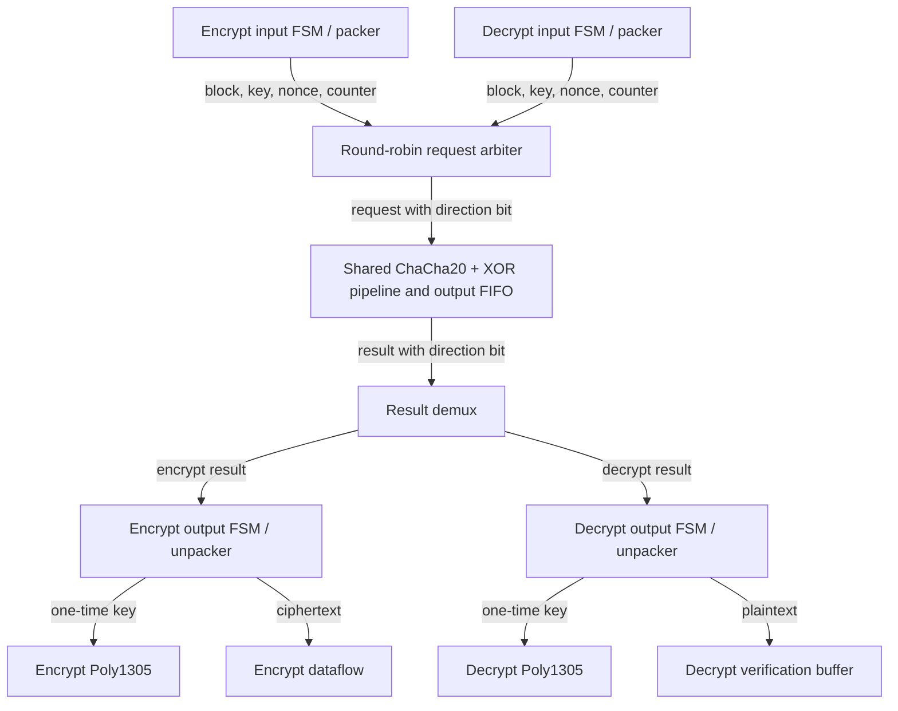

# ChaCha20 design

The default design shares one 512-bit ChaCha20 block pipeline between encrypt
and decrypt. Each direction keeps its own packet counters, input/output FSMs,
and width converters. Both directions use the same arithmetic: XOR with the
keystream encrypts plaintext or decrypts ciphertext.

See the build README for [configuration](../../README.md#design-parameters),
[full-design data flow](../../README.md#data-flow), and
[current measurements](../../README.md#current-results).

## Block pipeline

[chacha20.py](chacha20.py) implements the
[RFC 8439 block function](https://www.rfc-editor.org/rfc/rfc8439.html#section-2.3).
`chacha20_block_step` applies a column round and a diagonal round;
`chacha20_block` chains ten such steps, then adds the original state.
`chacha20_loop_body` builds the state from the key, nonce, and block counter,
serializes the result little-endian, and XORs it with the input block.
Byte enables and the last-block flag travel with the data; unused byte lanes
are zeroed.

`make_stream_auto_pipeline` wraps this arithmetic in an AUTO_PIPELINE with
valid/ready interfaces and output buffering. It can accept one 64-byte block
per clock when credits are available. PypelineC selects the pipeline depth for
the target clock; that depth also determines the outstanding-block limit.
Blocks are independent, so several packets and both directions can be in flight.

### Packet streams and the Poly1305 key

`chacha20_fsm` has independent input and output FSMs. For each packet, the input
FSM first submits an all-zero block with counter zero. The output FSM sends
the first 32 result bytes to Poly1305 as its one-time key. Payload blocks use
counters starting at one. This is
[key generation](https://www.rfc-editor.org/rfc/rfc8439.html#section-2.6);
Poly1305's later [key precomputation](../poly1305/poly1305_design.md#current-design)
is separate.

The output FSM waits for Poly1305 to accept the key before releasing that
packet's payload. Width converters pack and unpack 64-byte blocks: two beats
on the default 256-bit packet bus, or four on the 128-bit bus. A partial final
block retains its byte enables and packet boundary.

## Sharing between encrypt and decrypt

[chacha20_pipeline_shared.py](chacha20_pipeline_shared.py) supplies one shared
MAIN containing the arbiter, block pipeline, and result routing:

Arrows show data/valid; ready travels in reverse. The input and output FSMs
shown for each direction are the two halves of its private `chacha20_fsm`.

- Arbitration is per block, including key blocks. With both directions
  requesting, decrypt has initial priority and priority changes after each
  accepted request. With only one requesting, it can use every available slot.
- A stalled grant stays with its selected requester until acceptance, keeping
  the pipeline input stable. There is no lock for an entire packet.
- An `is_encrypt` bit accompanies each block through the arithmetic and output
  FIFO. It selects the receiving direction and that direction's ready signal.
  Results remain in launch order: a stalled receiver blocks later results from
  either direction, eventually exhausting credits and stopping new requests.

The `chacha20_encrypt_shared_adapter` and `chacha20_decrypt_shared_adapter`
definitions connect each FSM to the shared MAIN's `Wire` interfaces. When
sharing is disabled, `chacha20_if_func` instead connects the same FSM to a
private pipeline at each call site. The surrounding dataflow interface is
unchanged; sharing choices are listed in the README's
[parameter table](../../README.md#design-parameters).

Sharing gives both directions the combined capacity of one block per clock.
Key blocks, partial blocks, and downstream stalls consume some of that capacity,
so it is not an end-to-end payload throughput guarantee. See the README's
[bottleneck analysis](../../README.md#finding-a-bottleneck) for measurements.

## Source map

| Source | Responsibility |
| --- | --- |
| [chacha20.py](chacha20.py) | Block arithmetic, packet FSMs, width conversion, and private pipeline wiring. |
| [chacha20_pipeline_shared.py](chacha20_pipeline_shared.py) | Shared pipeline, arbitration, direction routing, and wire adapters. |
| [encrypt_dataflow.py](../chacha20poly1305/encrypt_dataflow.py), [decrypt_dataflow.py](../chacha20poly1305/decrypt_dataflow.py) | Select private or shared definitions for each dataflow. |
| [aead_types.py](../aead_types.py) | Stream types and downstream FIFO sizing from the selected pipeline's latency and credits. |

ChaCha20 is checked by the full AEAD testbenches against independent reference
results; use the README's [simulation workflow](../../README.md#simulation).
