# Poly1305 design

The current default accepts up to two 16-byte authentication blocks per clock on a
256-bit stream. Each direction has its own pipelined MAC, with interleaved
accumulators, two packet contexts, and private AUTO_FSM initialization/finalization.
The initialization/finalization [AUTO implementations](#auto_fsm-versus-auto_mcp)
use experimental PypelineC features and serve mainly as placeholders for future
hand-designed units. A nearer-term option is to size the AUTO_FSM latency
caps for smaller packets. The current throughput targets use 1420- and
1920-byte payloads.
The `inferred_body` arithmetic selection uses an inferred feedback multiplier
and Karatsuba elsewhere.

See the build README for [configuration](../../README.md#design-parameters),
[full-design data flow](../../README.md#data-flow), and
[current measurements](../../README.md#current-results). This document explains
the Poly1305 architecture and its throughput tradeoffs:

- [Breaking the serial chain](#breaking-the-serial-chain): the math that lets
  two blocks enter every clock, when the textbook loop takes one block at a
  time and waits for each result.
- [Current design](#current-design): how the hardware in
  [poly1305_mac_paired.py](poly1305_mac_paired.py) implements it.
- [Where the time goes](#where-the-time-goes): the measured per-packet cost of
  each stage, and which one limits throughput at each packet size.

## Breaking the serial chain

Poly1305 is a polynomial in the key `r`, evaluated modulo `p = 2^130 - 5`. The
RFC evaluates it one block at a time, and each step needs the previous step's
result. The default design computes the same polynomial with the terms
regrouped so that no step waits on the one before it. This section works
through one 20-block packet using the default build's real constants: 5
accumulator lanes, a 10-clock coefficient pipeline and a 5-clock feedback
pipeline, as the measurement summary reports them (`accumulators=5`,
`coefficient response=10 cycles`, `feedback response=5 cycles`). These
diagrams are drawn by hand from the math. The generated [`diagram.html`](../../0.doc/diagram.html) views
start at [current design](#current-design).

Notation: `c0 … c19` are the packet's 16-byte authentication blocks, each read
little-endian with bit 128 set; `r` is the clamped key, `s` the additive key,
and `q = r²`. Everything is modulo `p` until the final `+ s`.

### The legacy loop: one block at a time

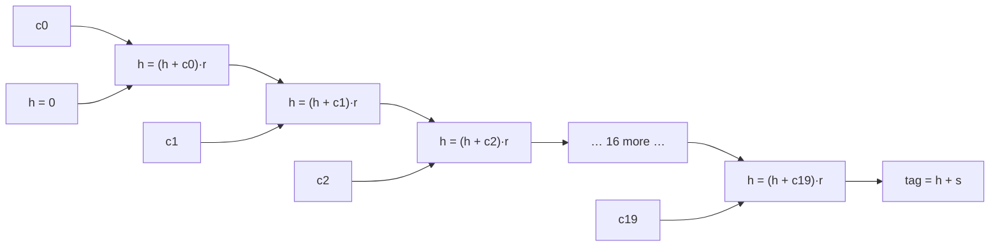

This is RFC 8439's loop, and it is what
[poly1305_legacy.py](poly1305_legacy.py) builds: `poly1305_mac_loop_body` adds
the block, multiplies by `r` and reduces, and `poly1305_mac_fsm` feeds it one
block at a time. Every box needs the `h` from the box before it, so the chain
is as long as the packet. The kernel runs as a five-cycle multi-cycle path
(`make_stream_auto_multi_cycle`) plus one handshake cycle, so a 16-byte block
enters every six clocks: 2.7 bytes per clock, about 1.7 Gb/s at 80 MHz. The
recorded [baseline](../../README.md#appendix-baseline-results) measured
1.62 Gb/s at 1920 bytes. A faster or pipelined multiplier does not remove the
wait, because the next block still needs this block's finished `h`.

### Same polynomial, regrouped

Unrolled, the loop computes

```text
h = c0·r²⁰ + c1·r¹⁹ + c2·r¹⁸ + … + c18·r² + c19·r
```

The loop is one order of evaluating this sum (Horner's rule). Modular
addition and multiplication can be reordered and factored like ordinary
algebra, so any grouping that leaves each block with its own power of `r`
gives the same `h`. The design uses two regroupings.

**Pairs.** Factor each pair of neighbouring terms:
`c0·r²⁰ + c1·r¹⁹ = r·q⁹·(c0·r + c1)`. Call the bracket `d0`. Then

```text
d_t = c_(2t)·r + c_(2t+1)                  (d0 = c0·r + c1, …, d9 = c18·r + c19)
h   = r·S,   S = d0·q⁹ + d1·q⁸ + … + d8·q + d9
```

`S` has ten terms in `q` where `h` had twenty in `r`. Each `d_t` needs only
its two blocks and `r`; no `d_t` depends on another, or on any running sum.

**Lanes.** Next, group the terms of `S` whose powers of `q` differ by 5:
`d0·q⁹ + d5·q⁴ = q⁴·(d0·q⁵ + d5)`. That bracket is accumulator lane `A0`,
built by the step `A = A·q⁵ + d` once per pair. Doing the same for every
pair gives five lanes:

| Pair | Blocks | Term of `S` | Lane | Lane after its pairs | Lane weight |
| ---: | --- | --- | --- | --- | --- |
| 0 | c0, c1 | d0·q⁹ | A0 | A0 = d0·q⁵ + d5 | q⁴ |
| 1 | c2, c3 | d1·q⁸ | A1 | A1 = d1·q⁵ + d6 | q³ |
| 2 | c4, c5 | d2·q⁷ | A2 | A2 = d2·q⁵ + d7 | q² |
| 3 | c6, c7 | d3·q⁶ | A3 | A3 = d3·q⁵ + d8 | q |
| 4 | c8, c9 | d4·q⁵ | A4 | A4 = d4·q⁵ + d9 | 1 |
| 5 | c10, c11 | d5·q⁴ | A0 | | |
| 6 | c12, c13 | d6·q³ | A1 | | |
| 7 | c14, c15 | d7·q² | A2 | | |
| 8 | c16, c17 | d8·q | A3 | | |
| 9 | c18, c19 | d9 | A4 | | |

Multiplying each lane by its weight gives back every term exactly once:
`S = A0·q⁴ + A1·q³ + A2·q² + A3·q + A4`. The new computation's dependency
graph, coloured by lane, is:

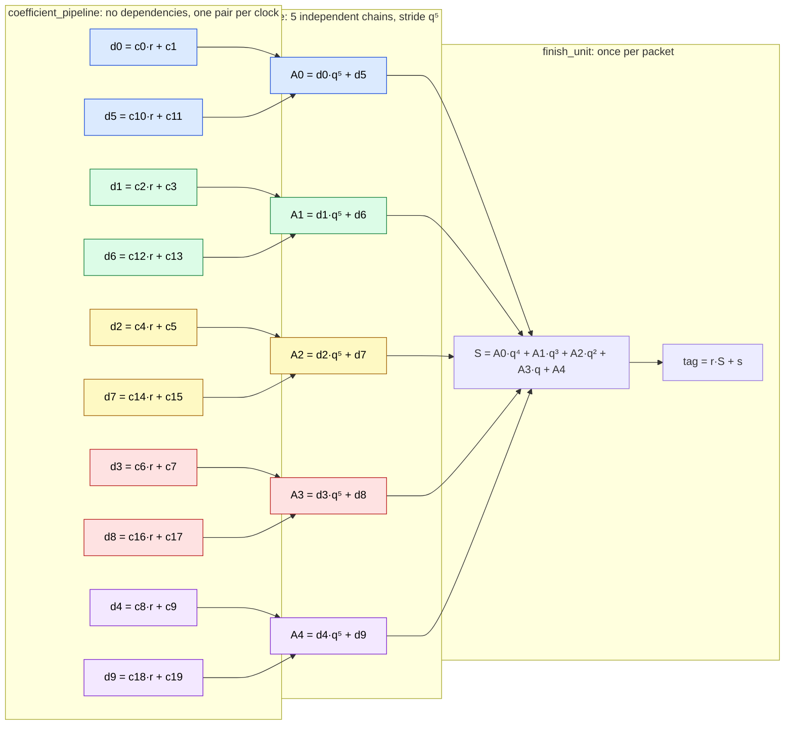

The longest chain is now two lane steps, where the loop had twenty. Each group
in the graph is one piece of hardware in the [body stage](#body-stage):

- **`coefficient_pipeline`**, the left group, computes `d = c0·r + c1`
  (`poly1305_pair_coefficient`). It reads no state, so it can start a new pair
  every clock and be as deep as timing needs.
- **`body_pipeline`**, the middle group, computes `A = A·q⁵ + d`
  (`poly1305_pair_accumulate`). A lane step needs only that lane's previous
  value, from five pairs earlier.
- **`finish_unit`** in the [finalization stage](#finalization-stage) does the
  right group once per packet: five weighted products, an add tree, the final
  `r`, and `+ s`. The powers `q … q⁵` come from `init_unit` in the
  [initialization stage](#initialization-stage), also once per packet.

The general formulas, for any lane count and for an odd block count, are in
[paired coefficients and interleaving](#paired-coefficients-and-interleaving).
The regrouping is exact: every simulated tag is checked against an independent
reference implementation. The
[original illustration/animation](https://share.gemini.google/dCzLp7lhYqaR)
shows the interleaving idea in motion.

### Five lanes hide the loop latency

The same 20 blocks over time, legacy loop against the default design:

```mermaid
---
displayMode: compact
---
gantt
    title 20 blocks, legacy loop versus paired interleaved body (clocks)
    dateFormat X
    axisFormat %s
    section Legacy loop
    c0 : 0, 5
    c1 : 6, 11
    c2 : 12, 17
    c3 : 18, 23
    c4 : 24, 29
    c5 : 30, 35
    c6 : 36, 41
    c7 : 42, 47
    c8 : 48, 53
    c9 : 54, 59
    c10 : 60, 65
    c11 : 66, 71
    c12 : 72, 77
    c13 : 78, 83
    c14 : 84, 89
    c15 : 90, 95
    c16 : 96, 101
    c17 : 102, 107
    c18 : 108, 113
    c19 : 114, 119
    section coefficient_pipeline
    d0 : 0, 10
    d1 : 1, 11
    d2 : 2, 12
    d3 : 3, 13
    d4 : 4, 14
    d5 : 5, 15
    d6 : 6, 16
    d7 : 7, 17
    d8 : 8, 18
    d9 : 9, 19
    section body_pipeline
    d0 into A0 : 10, 15
    d1 into A1 : 11, 16
    d2 into A2 : 12, 17
    d3 into A3 : 13, 18
    d4 into A4 : 14, 19
    d5 into A0 : 15, 20
    d6 into A1 : 16, 21
    d7 into A2 : 17, 22
    d8 into A3 : 18, 23
    d9 into A4 : 19, 24
```

- **Legacy loop:** one row, one block at a time: five clocks computing plus a
  handshake clock, 120 clocks in all.
- **`coefficient_pipeline`:** a new pair enters every clock and leaves ten
  clocks later. Nothing in it waits on anything else.
- **`body_pipeline`:** each row is one lane. `d0` enters lane `A0` at clock 10
  and its result returns at clock 15, exactly when `d5`, the lane's next pair,
  enters. The logic block passes the returning value straight to the new
  request (same-cycle forwarding). Meanwhile lanes `A1` to `A4` fill clocks 11
  to 14, so the pipeline takes a new pair every clock.

The lane count is set by the feedback latency: with a five-clock
`body_pipeline`, a lane can take a new pair every five clocks, so five lanes
keep it busy every clock. Fewer lanes would stall; more would only add powers
to precompute and products to finish. This is `L = feedback_core_latency + 2`
in [latency-derived constants](#latency-derived-constants). The coefficient
pipeline's depth adds latency (the ten clocks before the first `d0` arrives,
and a longer drain at packet end) but no lanes, because coefficients never wait
on an accumulator.

The body is done after 25 clocks instead of 120. In steady state it takes 32
bytes every clock, against 2.7 for the legacy loop: twelve times the rate. The
per-packet setup and finalization are not in this chart; they are in
[where the time goes](#where-the-time-goes).

### What each choice bought

| Choice | Removes | Costs |
| --- | --- | --- |
| Interleaved lanes (`A = A·r^L + c`, the 128-bit [poly1305_mac_pipelined.py](poly1305_mac_pipelined.py)) | The loop wait: one block per clock instead of one per six. | `L` accumulators per packet bank, the powers `r … r^L` in setup, and a weighted combine in finalization. |
| Pairs (`d = c0·r + c1`, default 256-bit) | One block per lane step: two blocks per clock, the full 256-bit beat. | The coefficient pipeline's extra multiplier, and the final `r` (or odd-tail) step in finalization. |
| Inferred feedback multiplier (`inferred_body`) | A deep feedback pipeline, which would need more lanes. | A wider single product on the feedback path; Karatsuba stays elsewhere ([multipliers](#multipliers-and-arithmetic-bounds)). |
| Two packet banks | A wait for the 15-clock drain before the next packet can stream. | A second bank of `r`, `s`, powers and accumulators. |
| Private setup and finalization units | Arbitration between encrypt and decrypt for each packet's setup and tag ([sharing](#shared-versus-private-compute-units)). | A setup unit and a finalization unit per direction. |
| AUTO_FSM for setup and finalization | Duplicated multipliers: each unit reuses a few multipliers over many clocks ([AUTO_FSM versus AUTO_MCP](#auto_fsm-versus-auto_mcp)). | 44 clocks of setup and 47 of finalization per packet, which sets the packet-rate floor ([where the time goes](#where-the-time-goes)). |

## Current design

We use **initialization** (`init`) and **finalization** (`finish`), matching the
[Secworks Poly1305 hardware interface](https://github.com/secworks/poly1305#usage).
Initialization clamps the packet key's `r` and performs **key precomputation**
(the powers needed by interleaved lanes).
[ChaCha20's one-time key generation](../chacha20/chacha20_design.md#packet-streams-and-the-poly1305-key)
is a separate step. Finalization reduces the completed lanes,
accounts for an unmatched block, and adds `s` to form the tag.

The diagrams below are the build's [`diagram.html`](../../0.doc/diagram.html) views of
[poly1305_mac_paired.py](poly1305_mac_paired.py), read as the README's
[data flow](../../README.md#data-flow) section describes: each wire is named by
the variable that carries it, ready signals are not drawn, and a dashed edge
passes through a `Feedback` variable. A rectangle labelled with operators
(`mux == | …`) is the function's own logic, with its register count.

`poly1305_mac_paired` is the `mac_func` of the README's
[encrypt](../../README.md#encrypt) and [decrypt](../../README.md#decrypt)
charts. It takes the packet key from ChaCha20 (`key_if`) and the framed
authentication data (`data_in_if`) from `prep_func`, and returns one tag per
packet (`auth_tag_if`). Inside, it is three stages in a row:

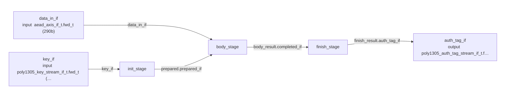

- [`init_stage`](#initialization-stage) turns the key into a prepared
  descriptor (`prepared.prepared_if`): `r`, `s` and the powers of `r`.
- [`body_stage`](#body-stage) authenticates two 16-byte blocks per beat into
  per-lane accumulators, and hands a completed packet's accumulators on
  (`body_result.completed_if`).
- [`finish_stage`](#finalization-stage) combines them into the tag
  (`finish_result.auth_tag_if`).

Each stage has its own state, and the stages hand over one packet at a time
through single-slot holding registers, so different packets can be in
different stages: the next packet's key is prepared, and the previous packet's
tag finalized, while the body stage streams. Each direction has its own MAC;
the arithmetic pipelines run every clock, including bubbles, and admission and
the holding registers provide backpressure at the MAC boundary.

### Initialization stage

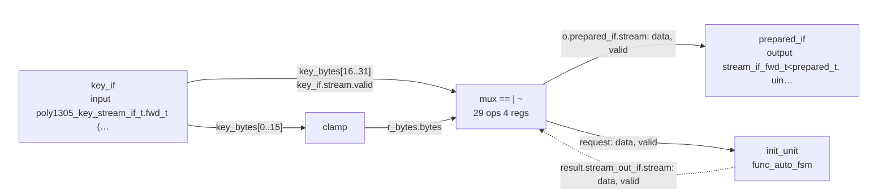

The 32-byte key splits into `r` (`key_bytes[0..15]`, clamped by `clamp`) and
`s` (`key_bytes[16..31]`). The logic block's four registers are the FSM
`state`, `r`, the `descriptor` being built, and `next_context`, the packet bank
the descriptor will claim in the body stage. Its FSM steps through `IDLE`
(accept a key), `INIT_LAUNCH` (send `r` to `init_unit` as `request`),
`INIT_WAIT` (take the powers back on the dashed `result` edge) and
`OUTPUT_DESCRIPTOR` (offer `prepared_if` until the body stage takes it).
`init_unit` is the key-precomputation function `init` in
[poly1305_compute.py](poly1305_compute.py) as an AUTO_FSM, a multi-cycle unit
private to this MAC; see [AUTO_FSM versus AUTO_MCP](#auto_fsm-versus-auto_mcp)
and, for one unit serving both directions,
[shared versus private compute units](#shared-versus-private-compute-units).

### Body stage

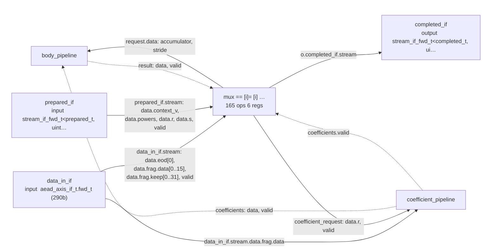

Each input beat carries a pair of 16-byte blocks. The pair's 32 bytes go
straight to `coefficient_pipeline`, which forms `d = c0*r + c1` modulo `p`
using the packet's `r` from the logic block (`coefficient_request`). Its result
(`coefficients`) is the coefficient input of `body_pipeline`, which updates one
accumulator, `A = A*q^L + d` modulo `p`; the logic block supplies that
accumulator and the stride `q^L` (`request.data`) and takes the updated value
back (`result`). The math is in
[paired coefficients and interleaving](#paired-coefficients-and-interleaving),
and the split into two pipelines in
[two pipelines per pair](#two-pipelines-per-pair).

The logic block holds the six registers that give this datapath its packet
state: the two packet `banks` (each a packet's `r`, `s`, powers, `L`
accumulators, saved tail block and outstanding count), `issue_context` and
`complete_context` (the bank now streaming and the bank to complete next),
`completion` (the completed bank's snapshot, offered on `completed_if`), and
the ownership delay lines `coefficient_owners` and `owners`. From
`data_in_if` it takes only the control fields: the byte enables (`keep`, which
tell a pair from a final single block), `eod`, and the first block
(`data[0..15]`), saved as the tail when it is unmatched. The three dashed
edges are `Feedback` variables, the pipeline results read before the calls
that compute them. Expanded by hand, the logic block and its two pipelines are:

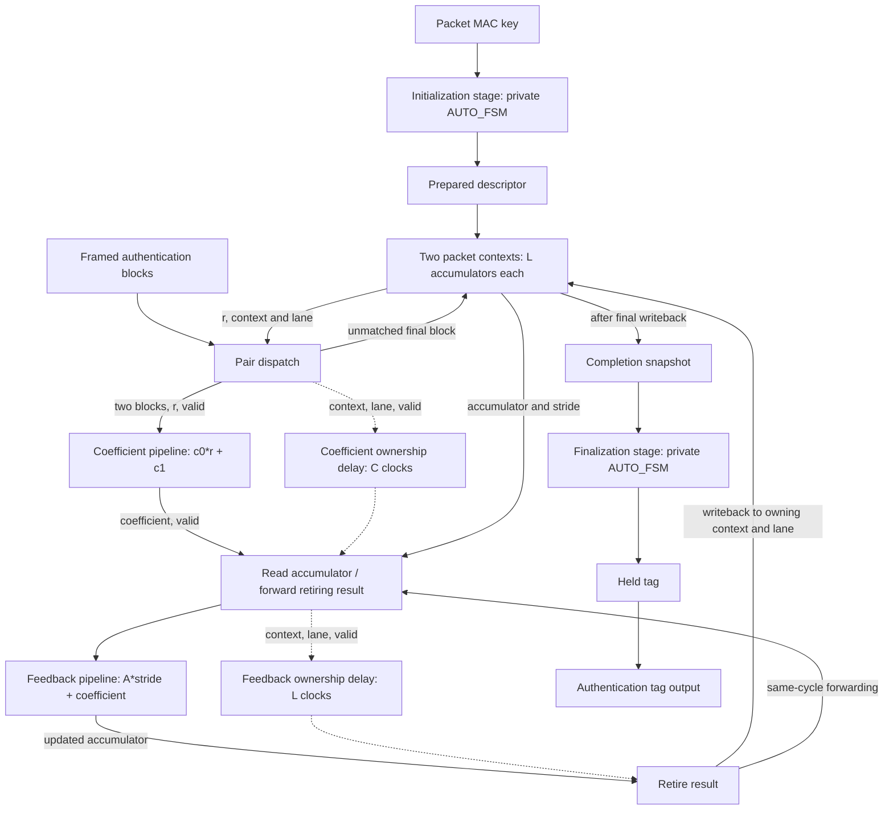

Here the dashed arrows are the ownership delays (`coefficient_owners`,
`owners`), which carry each pair's bank and lane alongside the arithmetic so
its result is written back to the right accumulator. A descriptor claims an
empty bank; the bank streams the packet, drains its outstanding results, and
is snapshotted into `completion` once its final writeback has landed, while
the other bank can already take the next packet. The
[latency-derived constants](#latency-derived-constants) and
[packet banks and backpressure](#packet-banks-and-backpressure) sections give
the details.

### Finalization stage

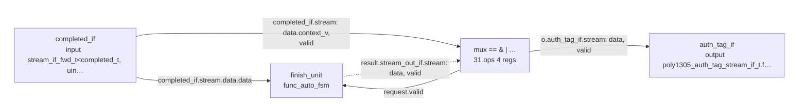

The completed bank's contents (`completed_if.stream.data.data`: accumulators,
powers, tail, `s`) go straight to `finish_unit`, the `finish` function of
[poly1305_compute.py](poly1305_compute.py) as an AUTO_FSM; the logic block only
launches it (`request.valid`) when idle. Its four registers are the FSM
`state` (`IDLE`, `FINISH_WAIT`, `OUTPUT_TAG`), the packet's context on launch
(`owner_context`) and on return (`tag_context`), checked against each other in
simulation, and the held `tag`, offered on `auth_tag_if` until the consumer
takes it. The finalization formula is in
[paired coefficients and interleaving](#paired-coefficients-and-interleaving).

### Implementation map

| Source | Throughput responsibility |
| --- | --- |
| [poly1305_select.py](poly1305_select.py) | Selects the MAC at elaboration and exposes latency, lane, and compute unit metadata. |
| [poly1305_mac_paired.py](poly1305_mac_paired.py) | Default two-block body, packet overlap, ownership tracking, and forwarding. |
| [poly1305_compute.py](poly1305_compute.py) | Both widths’ initialization/key precomputation, weighted finalization, payload types, and AUTO_FSM/AUTO_MCP wrappers. |
| [poly1305_math.py](poly1305_math.py) | Multiplier selection, exact-width arithmetic, and modular reduction. |
| [poly1305_compute_shared.py](poly1305_compute_shared.py) | Optional shared initialization/finalization compute units and per-direction adapters; supports both compute modes. |
| [poly1305_mac_pipelined.py](poly1305_mac_pipelined.py) | [One-block, 128-bit controller](#128-bit-controller-and-feedback), bank ownership, and feedback forwarding. |
| [poly1305_legacy.py](poly1305_legacy.py) | Selectable legacy single-accumulator MAC. |

### Paired coefficients and interleaving

For the standard algorithm, see [RFC 8439, Poly1305](https://www.rfc-editor.org/rfc/rfc8439.html#section-2.5).
Here `p = 2^130 - 5`, `r` is the clamped key, `s` is the additive key, and
`c_i = LE(block_i) + 2^128` for each complete, AEAD-padded 16-byte block.
The implementation groups consecutive blocks into pairs; all arithmetic below
is modulo `p` until the final tag addition:

```text
q = r*r
d_t = c_(2t)*r + c_(2t+1)
A_(t mod L) = A_(t mod L)*q^L + d_t

S = sum_j A_j * q^((M-1-j) mod L)       # M complete pairs
H = r*S                              # even number of blocks
H = q*S + r*c_tail                    # odd number of blocks instead
tag = (H+s) mod 2^128
```

Accumulators start at zero. Finalization rotates weights using the next lane
(`M mod L`); inactive lanes contribute zero and `q^0` is one even when `r=0`.
An unmatched final block bypasses both body pipelines and is saved for
finalization, without advancing a lane or inventing a second block. The odd-tail
expression computes its tail product independently of the lane reduction.

The wide formatter in [prep_auth_data.py](../prep_auth_data/prep_auth_data.py) pads AAD and
ciphertext separately to 16-byte boundaries, then packs pairs across those
boundaries and the final lengths block. A MAC input beat therefore contains
32 valid bytes, or 16 valid bytes on an unmatched final beat.

[Breaking the serial chain](#breaking-the-serial-chain) works these formulas
through for 20 blocks and five lanes; the [body stage](#body-stage) diagrams
describe the current wiring.

### Two pipelines per pair

The paired recurrence separates work that depends only on the incoming blocks
and key from work that needs an accumulator. Both pipelines accept one pair's
work per clock, so after filling they process different pairs concurrently.
This gives two authentication blocks per clock during continuous body input.
In the [body stage](#body-stage) view they are `coefficient_pipeline` and
`body_pipeline`; each wraps one function, an AUTO_PIPELINE with an input and an
output register.

`poly1305_pair_coefficient`, inside `coefficient_pipeline`:

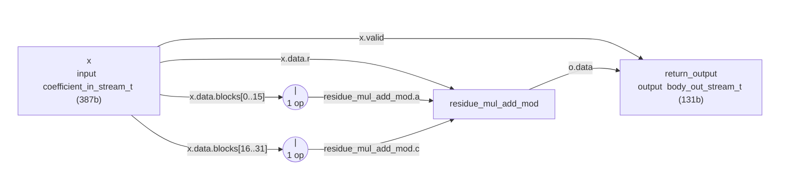

The two circles read the pair's blocks little-endian and set bit 128 of each
(`c0`, `c1`); `residue_mul_add_mod(c0, r, c1)` in
[poly1305_math.py](poly1305_math.py) returns `c0*r + c1` modulo `p`. The valid
bit passes alongside.

`poly1305_pair_accumulate`, inside `body_pipeline`:

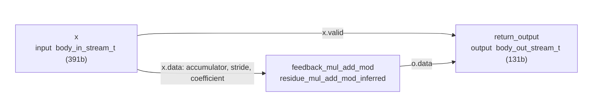

`feedback_mul_add_mod` returns `accumulator*stride + coefficient` modulo `p`.
With the default `inferred_body` selection it is
`residue_mul_add_mod_inferred`, an inferred multiplier, as the block's second
line shows; the coefficient path keeps the Karatsuba multiplier
([multipliers and arithmetic bounds](#multipliers-and-arithmetic-bounds)).

| Pipeline in [poly1305_mac_paired.py](poly1305_mac_paired.py) | Work for one pair | State dependency |
| --- | --- | --- |
| `coefficient_pipeline` / `poly1305_pair_coefficient` | Form `d = c0*r + c1` modulo `p`. | Uses the packet's `r`; no accumulator read. |
| `body_pipeline` / `poly1305_pair_accumulate` | Update `A = A*q^L + d` modulo `p`. | Read the owning bank/lane when its coefficient returns; forward a simultaneous writeback to that same lane. |

`coefficient_owners` delays each accepted pair's context, lane, and valid bit
to the accumulator read. `owners` then delays that ownership through feedback
to writeback. Both lines shift on every clock, so input gaps become bubbles
without moving the pair-admission lane. A pair increments the bank's outstanding
count at admission and decrements it only at feedback retirement; assertions
check ownership alignment, lane order, and that the bank has not been released.

### Latency-derived constants

`L = feedback_core_latency + 2` includes the feedback pipeline's input/output
registers and sets the number of accumulators per bank; coefficient delay is
`C = coefficient_core_latency + 2`. A pair takes `C + L` clocks from admission
to writeback, but only `L` separates an accumulator read from its result, so
coefficient delay adds no lanes. With continuous pairs, the same lane is read
again exactly as its previous result returns.
[Buffer sizing](../aead_types.py) uses the selected instances' resolved
latencies, credits, and stage handoffs, rounding memory depths to powers of two.

### Packet banks and backpressure

Each bank holds one packet's `r`, salt `s`, powers `q^1` through `q^L`, `L`
accumulators, admission/retirement lane indices, outstanding-pair count, and
optional tail. Initialization clamps `r` and precomputes the powers; finalization
combines a completed bank using the [paired formula](#paired-coefficients-and-interleaving).

| Bank state | Transition |
| --- | --- |
| `EMPTY` | Accept a prepared descriptor, clear accumulators, lane indices, and tail state, then become `READY`. |
| `READY` | Accept the packet's first beat when selected by `issue_context`. |
| `STREAM_BODY` | Advance the lane for each accepted pair; save an unmatched final block separately. The final beat enters `DRAIN` and switches issue to the other bank. |
| `DRAIN` | Retire all outstanding pairs, copy the bank into the completion register in packet order, then become `EMPTY`. |

A one-beat packet goes directly from `READY` to `DRAIN`; a tail-only packet
launches neither pipeline. The next bank may accept pairs while the previous
bank still has coefficients or feedback results in flight.

Snapshot eligibility uses the outstanding count from the start of the cycle,
so completion follows the last committed writeback. Copying the snapshot frees
the bank without waiting for finalization or the tag consumer; a new descriptor may
load that bank on the same edge, but body admission waits until the next cycle.
The completion register can likewise be consumed and refilled on the same edge.
A stalled tag is held stable and blocks the next finalization request; backpressure
reaches body admission when the completion slot and banks fill.

### Future option: rotating bank or lane storage

Both pipelined MACs use indexed banks. Key assignment, `issue_context`, and
`complete_context` each alternate `0, 1` on different events; result writeback
follows delayed ownership. In the paired MAC, admission, accumulator read, and
writeback are also separated by the two pipeline delays. Lane order is cyclic,
but gaps separate admission from delayed reads and writebacks. An unmatched
tail switches the issue context without advancing a lane.

The ownership metadata already shifts. Rotating accumulator storage remains
an option to investigate, with separate advance rules, preserved forwarding,
and correct lane ordering in completion snapshots. A common every-clock bank
rotation would not follow the current access pattern; any replacement needs
an area/timing comparison before adoption.

## Where the time goes

With the serial chain gone, the body stage no longer sets Poly1305's speed.
What remains is each packet's fixed cost. Each stage of the
[current design](#current-design) spends the following clocks per packet. The
figures come from the Poly1305 lifecycle table (`blocks.md`) of the measurement
behind the README's [current results](../../README.md#current-results); `N` is
the packet's authentication block count, defined in
[128-bit versus 256-bit bodies](#128-bit-versus-256-bit-bodies):

| Stage | Clocks per packet | What it is doing |
| --- | ---: | --- |
| [`init_stage`](#initialization-stage) | 44 | `init_unit` (a 43-cycle AUTO_FSM, plus its handshake) computing `q … q⁵`. |
| [`body_stage`](#body-stage), streaming | `ceil(N/2)` | One pair per clock. |
| [`body_stage`](#body-stage), draining | 15 | The last pair passing through both pipelines (10 + 5 clocks). |
| [`finish_stage`](#finalization-stage) | 47 + 1 | `finish_unit` (a 46-cycle AUTO_FSM, plus its handshake) weighting and combining the lanes, then one clock to hand over the tag. |

The stages work on different packets at the same time, so these costs overlap
rather than add up: the packet period is set by the busiest stage. The
schedules below are drawn from the stage costs above, for steady
back-to-back traffic.

```mermaid
---
displayMode: compact
---
gantt
    title 256-byte packets back to back (clocks)
    dateFormat X
    axisFormat %s
    section init_stage
    P0 setup : 0, 44
    P1 setup : 48, 92
    P2 setup : 96, 140
    P3 setup : 144, 188
    section body_stage
    P0 body : 44, 54
    P0 drain : 54, 69
    P1 body : 92, 102
    P1 drain : 102, 117
    P2 body : 140, 150
    P2 drain : 150, 165
    P3 body : 188, 198
    P3 drain : 198, 213
    section finish_stage
    P0 finish : 69, 116
    P1 finish : 117, 164
    P2 finish : 165, 212
    P3 finish : 213, 260
```

A 256-byte packet is 19 blocks, so the body streams for only 10 clocks. Each
`finish_unit` run takes 47 clocks plus the one-clock tag handoff, and it
handles one packet at a time, so `finish_stage` starts a new packet only every
48 clocks. That is the measured packet period. `init_stage` waits 4 clocks per
packet for it, and `body_stage` sits idle most of the time.

```mermaid
---
displayMode: compact
---
gantt
    title 1920-byte packets back to back (clocks)
    dateFormat X
    axisFormat %s
    section init_stage
    P0 setup : 0, 44
    P1 setup : 64, 108
    P2 setup : 128, 172
    section body_stage
    P0 body : 44, 106
    P0 drain : 106, 121
    P1 body : 108, 170
    P1 drain : 170, 185
    P2 body : 172, 234
    P2 drain : 234, 249
    section finish_stage
    P0 finish : 121, 168
    P1 finish : 185, 232
    P2 finish : 249, 296
```

A 1920-byte packet is 123 blocks, 62 body clocks, so now `body_stage` is the
busiest stage. Its two bars overlap because of the two
[packet banks](#packet-banks-and-backpressure): `P1` streams from one bank
while `P0` drains in the other, so the drain costs no throughput. The
measured period is 64 clocks: 62 body clocks plus about 2 for packet framing.
This is the 256-bit datapath's own limit, 30 of the 32 bytes it could take per
clock.

Measured across packet sizes:

| Payload bytes | `N` blocks | Body clocks | Measured period, encrypt / decrypt | Busiest stage |
| ---: | ---: | ---: | ---: | --- |
| 16 | 4 | 2 | 48 / 48 | `finish_stage` |
| 64 | 7 | 4 | 48 / 62 | `finish_stage`; decrypt waits for its key upstream |
| 256 | 19 | 10 | 48 / 48 | `finish_stage` |
| 1024 | 67 | 34 | 48 / 48 | `finish_stage` |
| 1420 | 92 | 46 | 49.3 / 50 | Both, about equal |
| 1920 | 123 | 62 | 64 / 64.3 | `body_stage` |

The bottlenecks, in order:

1. **Per-packet finalization, below about 1.4 KB.** The 48-clock floor holds
   from 16 to 1024 bytes, so short packets run at a fixed packet rate rather
   than a byte rate. `finish_unit` computes five lane products, an add tree
   and a final product. As an AUTO_FSM it reuses a few multipliers over 46
   cycles instead of building them all; [AUTO_MCP](#auto_fsm-versus-auto_mcp)
   would keep the parallel products, at more area. Fewer lanes mean less
   finalization and setup work, which is one reason for the shallow
   `inferred_body` feedback multiplier. `init_stage` is close behind at
   44 clocks: shortening finalization alone gains at most 4 clocks per packet
   before setup becomes the limit.
2. **The 256-bit beat, above about 1.4 KB.** The body takes a pair every
   clock, the full width of the stream. Going further would need more blocks
   per beat: a wider datapath, more coefficient arithmetic, and a longer
   finalization.
3. **Decrypt's next key, for some sizes.** At 64 bytes decrypt's period is 62
   clocks although its MAC stage costs match encrypt's. The extra wait is
   outside Poly1305: decrypt's next key comes out of ChaCha20 only after the
   current packet's keystream. To trace a wait like this, use the README's
   [bottleneck analysis](../../README.md#finding-a-bottleneck), which also
   covers the ChaCha20-to-Poly1305 key handoff.

Two things are not bottlenecks: the body arithmetic, at one pair per clock,
and ChaCha20, which serves 30.8 bytes per clock when fed at 1920 bytes.
Compared with the [legacy baseline](#baseline-reference), a 1920-byte packet
went from about 2.5 to 30 payload bytes per clock.

## AUTO_FSM versus AUTO_MCP

[poly1305_compute.py](poly1305_compute.py) applies this choice only to initialization
and finalization; the body remains automatically pipelined in both modes.
**AUTO_FSM and AUTO_MCP are experimental PypelineC features.** AUTO_MCP here
refers to the automatic multi-cycle-path mode (`AUTO_MULTI_CYCLE`). These AUTO
implementations of initialization (`init`) and finalization (`finish`) serve
mainly as placeholders so the pipelined body and full packet flow can be developed
and measured. The longer-term plan is to replace them with hand-designed init
and finish units, with arithmetic sharing and scheduling tailored to each kernel.

In the shorter term, the AUTO_FSM latency caps could be derived from a target
payload size and a required fraction of peak datapath throughput. For example,
sustaining 90% of the default 32 bytes/clock per direction on `B`-byte payloads
allows at most `B / (0.90 × 32)` clocks between packet completions on average.
For a 1024-byte payload, each private stage can therefore spend at most 35
whole clocks per packet. Init and finish overlap across packets, so each gets
that budget. Allowing one handshake clock for each and one more for the tag
handoff gives candidate AUTO_FSM caps of 34 clocks for init and 33 for finish.
The [end-to-end measurement](../../README.md#throughput-measurement) would
show whether the body and the rest of the packet path also sustain that rate.

| | AUTO_FSM (default) | AUTO_MCP |
| --- | --- | --- |
| Arithmetic | Schedules operations into clocked states and reuses arithmetic units across states. | Keeps the whole kernel combinational between its launch/capture registers, allowing multiple clocks for it to settle. |
| Resource tradeoff | Can reduce duplicated arithmetic, with added registers, multiplexers, and control. | Retains the kernel's parallel products; increasing lane count can make initialization/finalization expensive. |
| Latency selection | Schedules against timing and the configured initialization/finalization caps. | Selects a multi-cycle timing constraint for the complete kernel. |
| Request handling | One transaction at a time per compute unit. | One transaction at a time per compute unit. |

Both use a valid/ready wrapper that holds the result under backpressure.
Response latency and the unstalled request interval are `compute latency + 1`;
packet-stage handoffs and optional arbitration add further overhead.
FSM caps are upper bounds, not promises of an exact schedule or device fit.
The flags and default caps are in the README's
[design parameters](../../README.md#design-parameters).

Sharing arithmetic **within an AUTO_FSM** is distinct from sharing an entire
compute unit **between encrypt and decrypt**, described next. Private instances use
the same kernel definitions and matched schedules, but own separate hardware.

## Shared versus private compute units

Encrypt and decrypt each have private initialization and finalization compute units
by default.
Optional Poly1305 sharing replaces these four compute units with two: one shared
initialization and one shared finalization. Each direction still owns its body pipelines,
keys, powers, and accumulator banks.

[poly1305_compute_shared.py](poly1305_compute_shared.py) implements the following path
**separately for each phase**, for either AUTO_FSM or AUTO_MCP:

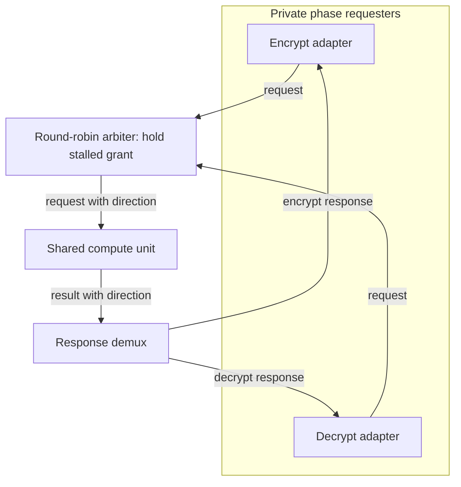

Arrows show data/valid; ready travels back along each connection. The two
`@MAIN` functions each instantiate one arbiter and compute unit, connected
to the direction requesters by `Wire` interfaces. Each compute unit handles one
outstanding request. There is no packet-wide lock: encrypt's initialization and
decrypt's finalization can run concurrently.

### Arbitration and backpressure

`make_compute_arbiter` applies the same rules in both compute modes:

| Event | Behavior |
| --- | --- |
| New selection with both directions requesting | Initial priority is decrypt; priority switches to the other direction after each accepted request. |
| Only one direction requests | Select it regardless of priority, unless a previous stalled grant is held. |
| Compute unit cannot accept | Hold the selected direction until acceptance; that requester must keep its valid and payload stable. A later peer request cannot replace it. |
| Result is stalled | The result's direction bit selects both output valid and response ready. The compute unit holds data and direction; this phase accepts no new request until the owner accepts the result. |
| Result is accepted | The compute unit can accept the next request on the same clock. |

The arbiter's `busy` register only tracks occupancy for performance probes;
the compute unit wrapper controls acceptance and result storage.

### Capacity and adapters

`CAPACITY` follows the matched encrypt/decrypt body latency, including its two
boundary registers, just like the [local lane count](#latency-derived-constants).
`make_shared_compute_adapters` adds no buffering: it returns only the MAC's local powers
and zero-pads unused accumulator/power slots in finalization requests. `lane_count`
and `next_lane` keep weight rotation local to the requester; inactive slots
contribute zero. The paired adapter also forwards `r`, `tail`, and `has_tail`.
Both widths’ kernels and payload types live in
[poly1305_compute.py](poly1305_compute.py); arbitration and wire binding remain
in [poly1305_compute_shared.py](poly1305_compute_shared.py). The
`encrypt_init_shared_adapter`, `decrypt_init_shared_adapter`, and corresponding
`finish` definitions connect direction-local logic to global wires. The payload
adapters resize the local powers and completion snapshots without storage.

Sharing saves duplicated compute units but makes the two directions compete for each
phase. Under continuous equal demand, a compute unit with compute latency `T` has a
best-case per-direction interval of `2*(T+1)` cycles, before local handoffs or
stalls. Private compute units remove that arbitration cost, which matters when the
256-bit body finishes packets quickly. See the README for
[sharing selectors](../../README.md#design-parameters).

## 128-bit versus 256-bit bodies

Both pipelined variants interleave lanes and overlap packet stages. Selection
is static; the unused variant creates no hardware. Packet width changes across
the AEAD design, while Poly1305's mathematical block remains 16 bytes.

| | 128-bit interleaved | 256-bit paired (default) |
| --- | --- | --- |
| Body work per accepted beat | One authentication block. | Two blocks, or one unmatched final block. |
| Arithmetic path | One feedback pipeline. | Coefficient pipeline followed by feedback pipeline. |
| Lane stride | `r^L`. | `q^L`, where `q=r^2`. |
| Finalization | Rotate powers of `r` and combine lanes. | Rotate powers of `q`, combine lanes, and apply the final `r`/tail step. |
| Ideal body admission | `N` cycles for `N` blocks. | `ceil(N/2)` cycles for `N` blocks. |

The 128-bit recurrence is `A_j = A_j*r^L + c_i`, with `j = i mod L`;
finalization computes `sum_j A_j*r^(1+((N-1-j) mod L))`, then adds `s` for the
tag. These weights differ from the paired formula above.

An initiation interval of one means one body request per cycle while streaming,
not one complete packet per cycle. Widening can double body capacity, but adds
coefficient arithmetic and finalization work; initialization time, framing, and
backpressure can still limit payload throughput, particularly for short packets.
For `AAD_bytes` and `ciphertext_bytes`, the authentication block count is
`N = ceil(AAD_bytes/16) + ceil(ciphertext_bytes/16) + 1`.
Use the README's [bottleneck analysis](../../README.md#finding-a-bottleneck)
to distinguish those limits; overlapping stages must not be summed as a
sequential packet budget.

### 128-bit controller and feedback

[poly1305_mac_pipelined.py](poly1305_mac_pipelined.py) implements this path.
Each bank holds one packet's powers, salt `s`, `L` accumulators, next issue and
retirement lanes, and outstanding-result count. Initialization clamps `r` and
precomputes `r^1` through `r^L`; finalization weights the completed accumulators
and combines them with a balanced modular-add tree before adding `s`.

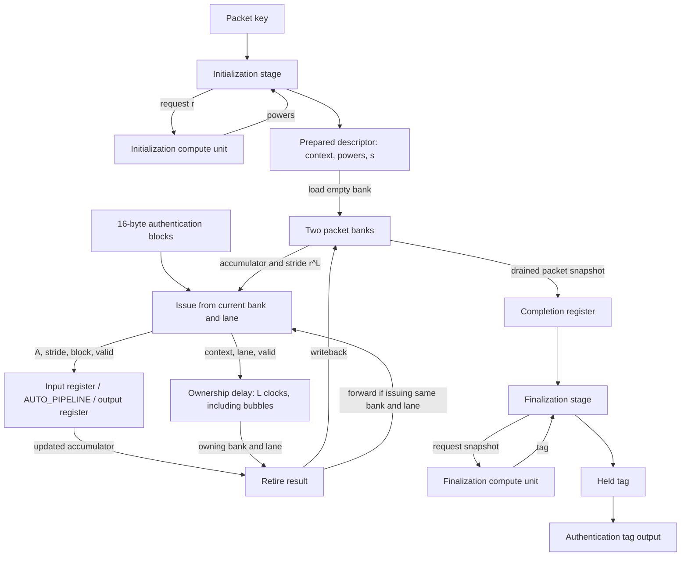

The compute unit boxes are private by default; optional
[sharing](#shared-versus-private-compute-units) changes those compute units, while each
MAC keeps this controller and storage.

The [bank lifecycle and backpressure](#packet-banks-and-backpressure) follow
the paired controller's rules, with each block advancing a lane and no
coefficient or tail path. A one-block packet goes directly from `READY` to
`DRAIN`. The single ownership delay tracks each block from accumulator read
to writeback over `L` clocks; same-cycle forwarding supports continuous input.

## Multipliers and arithmetic bounds

[poly1305_math.py](poly1305_math.py) selects arithmetic by operand type.
For the default, `make_mult_karatsuba_inferred_leaves` handles 130-bit products
with a 34-bit recursion threshold and inferred DSP-mappable leaves; specialized
squares reuse equal-operand work in key precomputation. `feedback_mul_add_mod`
instead pins a wide inferred product: a shallower feedback pipeline needs fewer
lanes, reducing the key-precomputation and finalization work as well.
The [multiplier options](../../README.md#design-parameters) retain the other
choices for comparisons.

Thanks to **FPGA-House-AG** for the
[Karatsuba DSP multiplier reference](https://github.com/FPGA-House-AG/ChaCha20Poly1305/blob/7e75c097af32429ff2c7979b976fe876efbdb9f3/src_dsp_opt/mul_136_kar.vhd)
that inspired this decomposition. See the
[Karatsuba algorithm](https://en.wikipedia.org/wiki/Karatsuba_algorithm) for the
general mathematics; this implementation uses Pypeline arithmetic rather than
copied VHDL.

Lane state and powers are canonical 130-bit residues. Full products and
multiply-adds retain 260 bits before `uint260_mod_prime` reduces them using
two folds of `2^130 = 5 (mod p)` and a final conditional subtraction; additions
retain their 131-bit carry. Powers and feedback operands are general residues,
so multipliers cannot assume the original key's clamped bit pattern. The
legacy path separately retains corrected 320-bit limb helpers.

## Verification

Poly1305 is verified through the full AEAD build-and-simulate workflow, with
independent reference tags, packet ordering, and backpressure checks. Follow
the README's [simulation](../../README.md#simulation) and
[measurement](../../README.md#measuring-qor) instructions; performance conclusions
use the built pipeline latencies and FSM schedules.

Standalone [paired-path](paired_path_tb.py) and
[MAC/component](mac_components_tb.py) testbenches also exist for focused debugging.
The native paired-path modes check the 256-bit MAC, authentication framing, and
tag append/strip paths. The hardware-style MAC/component modes check the one-block
MAC, body pipeline, arithmetic, and private/shared compute units (sharing supports
either width). Both cover backpressure and use independent reference results.

[Functional coverage](../../README.md#functional-coverage) records which MAC
lane takes each packet's final pair (`cover.poly.final_lane*`) and whether a
packet has fewer pairs than lanes. The lane count follows the body latency, so
a build with another latency shows its new lanes as unreached corners.

## Legacy architecture

The selectable fallback in [poly1305_legacy.py](poly1305_legacy.py) uses a single accumulator
and a private multi-cycle body per direction:

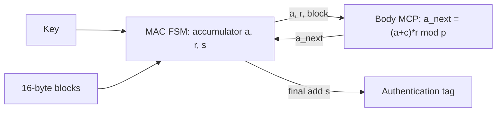

Each block waits for the preceding accumulator result
([the legacy loop](#the-legacy-loop-one-block-at-a-time) shows the chain and
its timeline). The recorded baseline
used a five-cycle MCP plus its handshake cycle: one block every six clocks.
The automatic search starts at five but may increase the count for timing.
There is no key-precomputation initialization; finalization is the FSM's addition of
`s`. Legacy is limited to 128-bit streams and inferred multiplication, without
shared Poly1305 compute units; see the [configuration table](../../README.md#design-parameters).

### Corrections from the earlier PipelineC implementation

The Pypeline legacy fallback already includes arithmetic fixes; it is distinct
from the [original C helpers](../../../pipelinec_build/src/poly1305/poly1305.h):

- Limb multiplication retains full 128-bit products and propagates carries.
- Reduction uses the correct `0x3` mask in limb 2, folds all upper limbs, and
  subtracts the complete modulus, including its top limb, when needed.

There is also a framing difference in the old
[encrypt testbench](../../../pipelinec_build/src/chacha20poly1305/encrypt_tb.c):
it marks zero-padding in a partial final plaintext beat as valid input.
The Pypeline testbenches preserve the actual byte count, and the
[authentication formatter](../prep_auth_data/prep_auth_data.py) pads only the
MAC input while recording the unpadded length. Tags and output lengths from
those old fixtures are therefore not the expected results for this design.

## Intermediate design: duplicated MCP engines

This **unimplemented alternative** explains how staggered multi-cycle engines
could approximate an interleaved pipeline. Dispatch consecutive blocks to
separate engines, each updating one lane with the 128-bit strided recurrence
`A_j*r^L + c_i`, then use the same rotated end-of-packet combine.

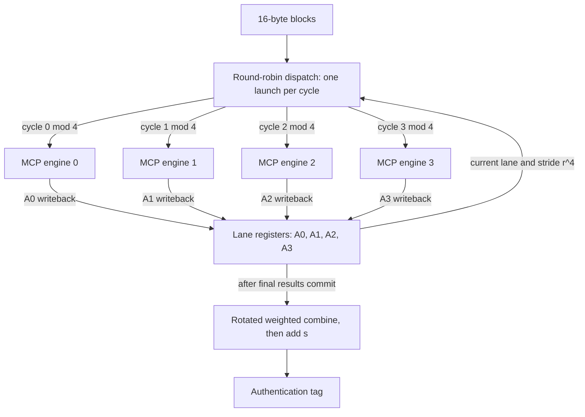

Four lanes are illustrative: one launch per clock requires each engine's full
transaction interval, including handshake and feedback availability, to fit within
four cycles. A six-cycle interval would need at least six engines. This duplicates
arithmetic hardware; the implemented interleaved body uses one pipeline per
arithmetic stage, with multiple operations in flight. Duplicating the original
`(a+c)*r` loop unchanged would not compute the required strided lane recurrence.

## Baseline reference

The branch's throughput work is compared with the corrected **Pypeline legacy**
MAC: 128-bit streams, a six-cycle body loop, and shared ChaCha20 at 80 MHz.
It is not a measurement of the unfixed PipelineC arithmetic. The
[README baseline appendix](../../README.md#appendix-baseline-results) retains
the recorded rates and provenance; the
[current results](../../README.md#current-results) remain separate.

Baseline area came from a synthesized performance testbench and is not directly
comparable with today's external-port hardware-top area. Clock, width, compute units,
and integration buffering also changed, so the overall gain is not an isolated
Poly1305 arithmetic comparison.
