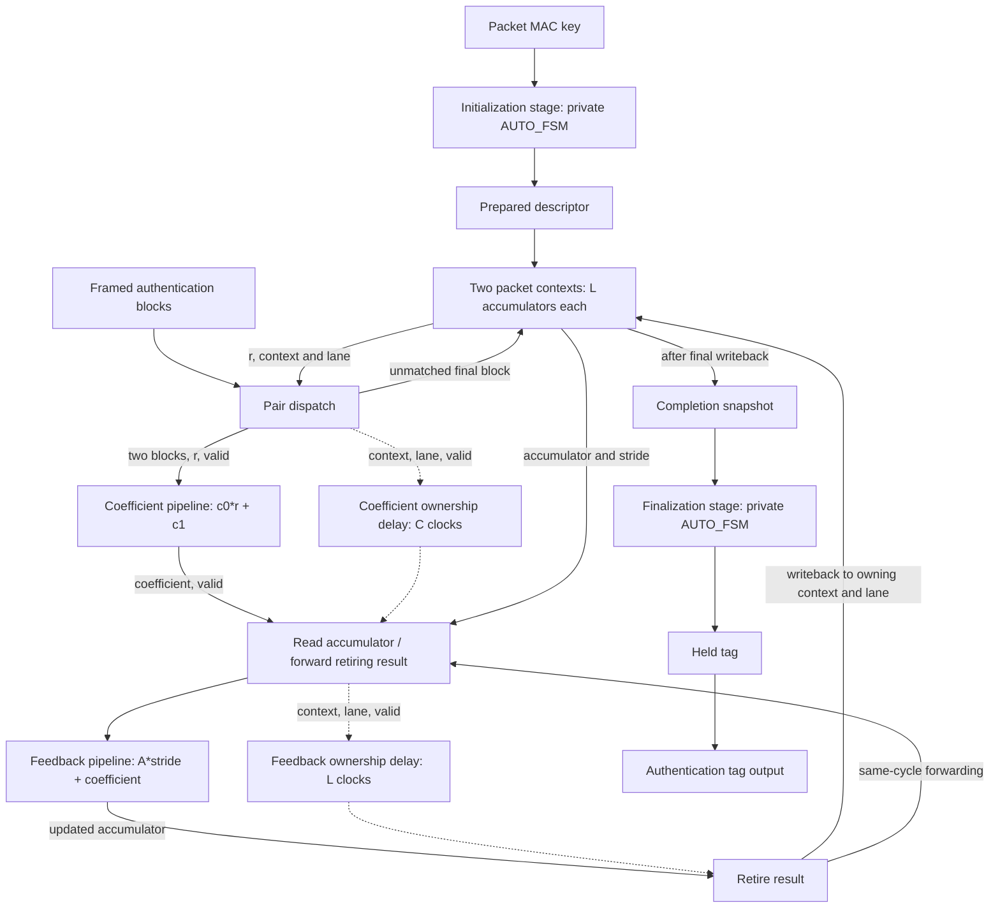
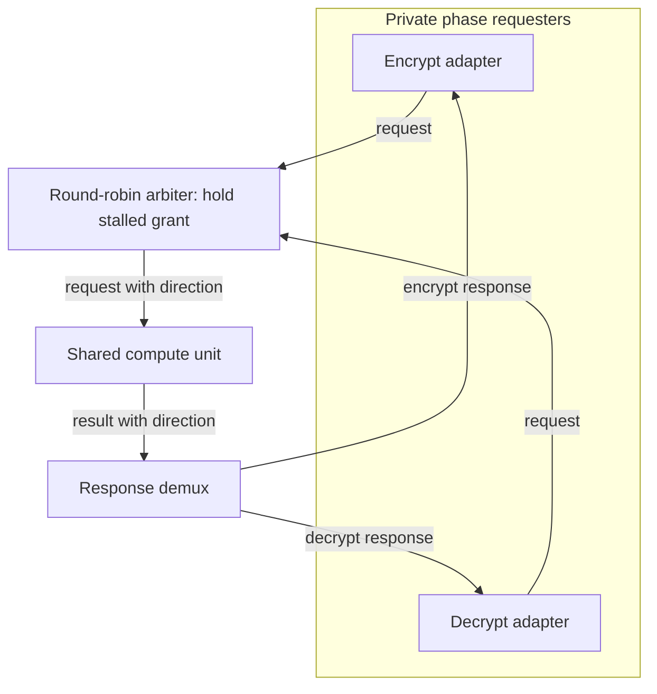
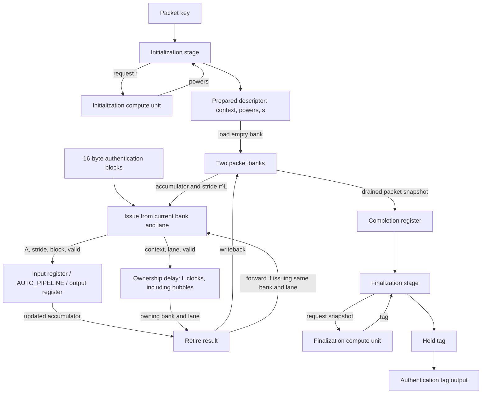
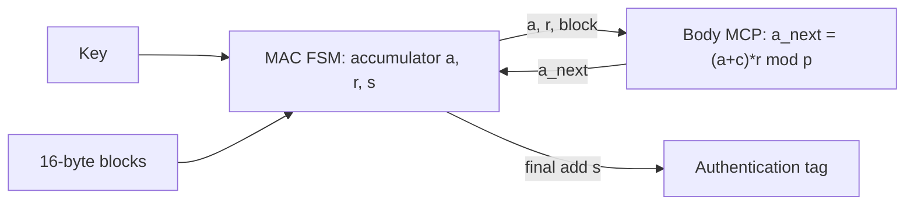
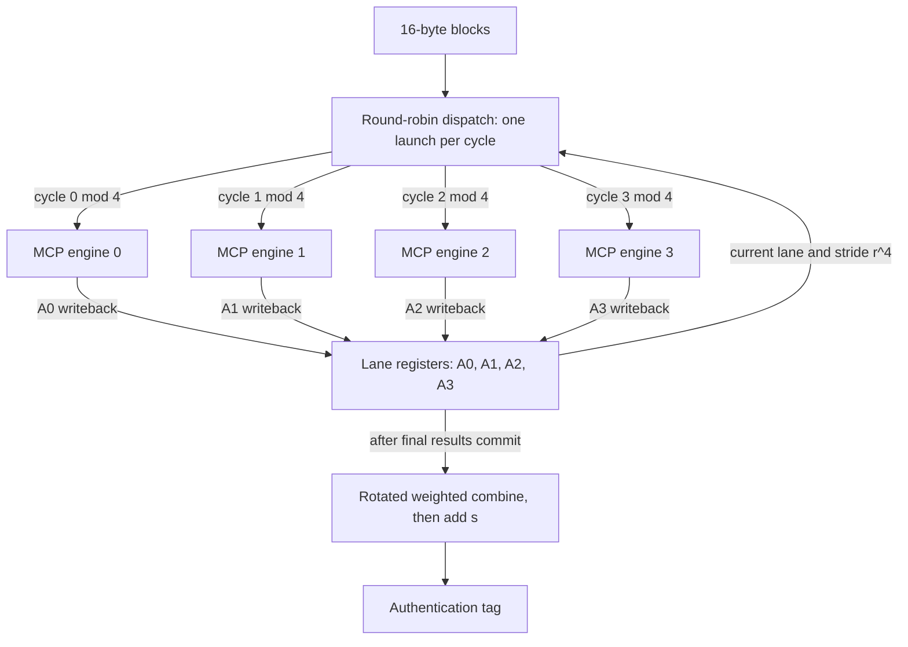

# Poly1305 design

The current default accepts up to two 16-byte authentication blocks per clock on a
256-bit stream. Each direction has its own pipelined MAC, with interleaved
accumulators, two packet contexts, and private AUTO_FSM initialization/finalization.
The `inferred_body` arithmetic selection uses an inferred feedback multiplier
and Karatsuba elsewhere.

See the build README for [configuration](../../README.md#design-parameters),
[full-design data flow](../../README.md#data-flow), and
[current measurements](../../README.md#current-results). This document explains
the Poly1305 architecture and its throughput tradeoffs.

## Current design

We use **initialization** (`init`) and **finalization** (`finish`), matching the
[Secworks Poly1305 hardware interface](https://github.com/secworks/poly1305#usage).
Initialization clamps the packet key’s `r` and performs **key precomputation**
(the powers needed by interleaved lanes).
[ChaCha20's one-time key generation](../chacha20/chacha20_design.md#packet-streams-and-the-poly1305-key)
is a separate step. Finalization reduces the completed lanes,
accounts for an unmatched block, and adds `s` to form the tag.

Each MAC has independent initialization, body, and finalization
stages. Two accumulator banks let the next packet enter the body while the
previous packet drains or finalizes. One coefficient pipeline and one feedback
pipeline serve both banks within that MAC. Every complete pair passes through
both pipelines in sequence.



The diagram follows [poly1305_mac_paired.py](poly1305_mac_paired.py).
Dashed arrows show the separate ownership delays alongside the arithmetic.
The prepared descriptor, completion snapshot, and held tag each
have one slot. The arithmetic pipelines run every clock, including bubbles;
admission and the holding registers provide backpressure at the MAC boundary.

### Implementation map

| Source | Throughput responsibility |
| --- | --- |
| [poly1305_select.py](poly1305_select.py) | Selects the MAC at elaboration and exposes latency, lane, and compute unit metadata. |
| [poly1305_mac_paired.py](poly1305_mac_paired.py) | Default two-block body, packet overlap, ownership tracking, and forwarding. |
| [poly1305_compute.py](poly1305_compute.py) | Both widths’ initialization/key precomputation, weighted finalization, payload types, and AUTO_FSM/AUTO_MCP wrappers. |
| [poly1305_math.py](poly1305_math.py) | Multiplier selection, exact-width arithmetic, and modular reduction. |
| [poly1305_compute_shared.py](poly1305_compute_shared.py) | Optional shared initialization/finalization compute units and per-direction adapters; supports both compute modes. |
| [poly1305_mac_pipelined.py](poly1305_mac_pipelined.py) | [One-block, 128-bit controller](#128-bit-controller-and-feedback), bank ownership, and feedback forwarding. |
| [poly1305_legacy.py](poly1305_legacy.py) | Selectable legacy single-accumulator MAC. |

### Paired coefficients and interleaving

For the standard algorithm, see [RFC 8439, Poly1305](https://www.rfc-editor.org/rfc/rfc8439.html#section-2.5).
Here `p = 2^130 - 5`, `r` is the clamped key, `s` is the additive key, and
`c_i = LE(block_i) + 2^128` for each complete, AEAD-padded 16-byte block.
The implementation groups consecutive blocks into pairs; all arithmetic below
is modulo `p` until the final tag addition:

```text
q = r*r
d_t = c_(2t)*r + c_(2t+1)
A_(t mod L) = A_(t mod L)*q^L + d_t

S = sum_j A_j * q^((M-1-j) mod L)       # M complete pairs
H = r*S                              # even number of blocks
H = q*S + r*c_tail                    # odd number of blocks instead
tag = (H+s) mod 2^128
```

Accumulators start at zero. Finalization rotates weights using the next lane
(`M mod L`); inactive lanes contribute zero and `q^0` is one even when `r=0`.
An unmatched final block bypasses both body pipelines and is saved for
finalization, without advancing a lane or inventing a second block. The odd-tail
expression computes its tail product independently of the lane reduction.

The [wide formatter](../prep_auth_data/prep_auth_data_wide.py) pads AAD and
ciphertext separately to 16-byte boundaries, then packs pairs across those
boundaries and the final lengths block. A MAC input beat therefore contains
32 valid bytes, or 16 valid bytes on an unmatched final beat.

The original [algorithm illustration/animation](https://share.gemini.google/dCzLp7lhYqaR)
is retained as a conceptual aid; the diagram above describes the current wiring.

### Two pipelines per pair

The paired recurrence separates work that depends only on the incoming blocks
and key from work that needs an accumulator. Both pipelines accept one pair's
work per clock, so after filling they process different pairs concurrently.
This gives two authentication blocks per clock during continuous body input.

| Pipeline in [poly1305_mac_paired.py](poly1305_mac_paired.py) | Work for one pair | State dependency |
| --- | --- | --- |
| `coefficient_pipeline` / `poly1305_pair_coefficient` | Form `d = c0*r + c1` modulo `p`. | Uses the packet's `r`; no accumulator read. |
| `body_pipeline` / `poly1305_pair_accumulate` | Update `A = A*q^L + d` modulo `p`. | Read the owning bank/lane when its coefficient returns; forward a simultaneous writeback to that same lane. |

`coefficient_owners` delays each accepted pair's context, lane, and valid bit
to the accumulator read. `owners` then delays that ownership through feedback
to writeback. Both lines shift on every clock, so input gaps become bubbles
without moving the pair-admission lane. A pair increments the bank's outstanding
count at admission and decrements it only at feedback retirement; assertions
check ownership alignment, lane order, and that the bank has not been released.

### Latency-derived constants

`L = feedback_core_latency + 2` includes the feedback pipeline's input/output
registers and sets the number of accumulators per bank; coefficient delay is
`C = coefficient_core_latency + 2`. A pair takes `C + L` clocks from admission
to writeback, but only `L` separates an accumulator read from its result, so
coefficient delay adds no lanes. With continuous pairs, the same lane is read
again exactly as its previous result returns.
[Buffer sizing](../aead_types.py) uses the selected instances' resolved
latencies, credits, and stage handoffs, rounding memory depths to powers of two.

### Packet banks and backpressure

Each bank holds one packet's `r`, salt `s`, powers `q^1` through `q^L`, `L`
accumulators, admission/retirement lane indices, outstanding-pair count, and
optional tail. Initialization clamps `r` and precomputes the powers; finalization
combines a completed bank using the [paired formula](#paired-coefficients-and-interleaving).

| Bank state | Transition |
| --- | --- |
| `EMPTY` | Accept a prepared descriptor, clear accumulators, lane indices, and tail state, then become `READY`. |
| `READY` | Accept the packet's first beat when selected by `issue_context`. |
| `STREAM_BODY` | Advance the lane for each accepted pair; save an unmatched final block separately. The final beat enters `DRAIN` and switches issue to the other bank. |
| `DRAIN` | Retire all outstanding pairs, copy the bank into the completion register in packet order, then become `EMPTY`. |

A one-beat packet goes directly from `READY` to `DRAIN`; a tail-only packet
launches neither pipeline. The next bank may accept pairs while the previous
bank still has coefficients or feedback results in flight.

Snapshot eligibility uses the outstanding count from the start of the cycle,
so completion follows the last committed writeback. Copying the snapshot frees
the bank without waiting for finalization or the tag consumer; a new descriptor may
load that bank on the same edge, but body admission waits until the next cycle.
The completion register can likewise be consumed and refilled on the same edge.
A stalled tag is held stable and blocks the next finalization request; backpressure
reaches body admission when the completion slot and banks fill.

### Future option: rotating bank or lane storage

Both pipelined MACs use indexed banks. Key assignment, `issue_context`, and
`complete_context` each alternate `0, 1` on different events; result writeback
follows delayed ownership. In the paired MAC, admission, accumulator read, and
writeback are also separated by the two pipeline delays. Lane order is cyclic,
but gaps separate admission from delayed reads and writebacks. An unmatched
tail switches the issue context without advancing a lane.

The ownership metadata already shifts. Rotating accumulator storage remains
an option to investigate, with separate advance rules, preserved forwarding,
and correct lane ordering in completion snapshots. A common every-clock bank
rotation would not follow the current access pattern; any replacement needs
an area/timing comparison before adoption.

## AUTO_FSM versus AUTO_MCP

[poly1305_compute.py](poly1305_compute.py) applies this choice only to initialization
and finalization; the body remains automatically pipelined in both modes.
**AUTO_FSM is experimental**, used here as a short-term alternative to writing
resource-sharing arithmetic FSMs by hand. AUTO_MCP here refers to PypelineC's
automatic multi-cycle-path mode (`AUTO_MULTI_CYCLE`).

| | AUTO_FSM (default) | AUTO_MCP |
| --- | --- | --- |
| Arithmetic | Schedules operations into clocked states and reuses arithmetic units across states. | Keeps the whole kernel combinational between its launch/capture registers, allowing multiple clocks for it to settle. |
| Resource tradeoff | Can reduce duplicated arithmetic, with added registers, multiplexers, and control. | Retains the kernel's parallel products; increasing lane count can make initialization/finalization expensive. |
| Latency selection | Schedules against timing and the configured initialization/finalization caps. | Selects a multi-cycle timing constraint for the complete kernel. |
| Request handling | One transaction at a time per compute unit. | One transaction at a time per compute unit. |

Both use a valid/ready wrapper that holds the result under backpressure.
Response latency and the unstalled request interval are `compute latency + 1`;
packet-stage handoffs and optional arbitration add further overhead.
FSM caps are upper bounds, not promises of an exact schedule or device fit.
The flags and default caps are in the README's
[design parameters](../../README.md#design-parameters).

Sharing arithmetic **within an AUTO_FSM** is distinct from sharing an entire
compute unit **between encrypt and decrypt**, described next. Private instances use
the same kernel definitions and matched schedules, but own separate hardware.

## Shared versus private compute units

Encrypt and decrypt each have private initialization and finalization compute units
by default.
Optional Poly1305 sharing replaces these four compute units with two: one shared
initialization and one shared finalization. Each direction still owns its body pipelines,
keys, powers, and accumulator banks.

[poly1305_compute_shared.py](poly1305_compute_shared.py) implements the following path
**separately for each phase**, for either AUTO_FSM or AUTO_MCP:



Arrows show data/valid; ready travels back along each connection. The two
`@MAIN` functions each instantiate one arbiter and compute unit, connected
to the direction requesters by `Wire` interfaces. Each compute unit handles one
outstanding request. There is no packet-wide lock: encrypt's initialization and
decrypt's finalization can run concurrently.

### Arbitration and backpressure

`make_compute_arbiter` applies the same rules in both compute modes:

| Event | Behavior |
| --- | --- |
| New selection with both directions requesting | Initial priority is decrypt; priority switches to the other direction after each accepted request. |
| Only one direction requests | Select it regardless of priority, unless a previous stalled grant is held. |
| Compute unit cannot accept | Hold the selected direction until acceptance; that requester must keep its valid and payload stable. A later peer request cannot replace it. |
| Result is stalled | The result's direction bit selects both output valid and response ready. The compute unit holds data and direction; this phase accepts no new request until the owner accepts the result. |
| Result is accepted | The compute unit can accept the next request on the same clock. |

The arbiter's `busy` register only tracks occupancy for performance probes;
the compute unit wrapper controls acceptance and result storage.

### Capacity and adapters

`CAPACITY` follows the matched encrypt/decrypt body latency, including its two
boundary registers, just like the [local lane count](#latency-derived-constants).
`make_shared_compute_adapters` adds no buffering: it returns only the MAC's local powers
and zero-pads unused accumulator/power slots in finalization requests. `lane_count`
and `next_lane` keep weight rotation local to the requester; inactive slots
contribute zero. The paired adapter also forwards `r`, `tail`, and `has_tail`.
Both widths’ kernels and payload types live in
[poly1305_compute.py](poly1305_compute.py); arbitration and wire binding remain
in [poly1305_compute_shared.py](poly1305_compute_shared.py). The
`encrypt_init_shared_adapter`, `decrypt_init_shared_adapter`, and corresponding
`finish` definitions connect direction-local logic to global wires. The payload
adapters resize the local powers and completion snapshots without storage.

Sharing saves duplicated compute units but makes the two directions compete for each
phase. Under continuous equal demand, a compute unit with compute latency `T` has a
best-case per-direction interval of `2*(T+1)` cycles, before local handoffs or
stalls. Private compute units remove that arbitration cost, which matters when the
256-bit body finishes packets quickly. See the README for
[sharing selectors](../../README.md#design-parameters).

## 128-bit versus 256-bit bodies

Both pipelined variants interleave lanes and overlap packet stages. Selection
is static; the unused variant creates no hardware. Packet width changes across
the AEAD design, while Poly1305's mathematical block remains 16 bytes.

| | 128-bit interleaved | 256-bit paired (default) |
| --- | --- | --- |
| Body work per accepted beat | One authentication block. | Two blocks, or one unmatched final block. |
| Arithmetic path | One feedback pipeline. | Coefficient pipeline followed by feedback pipeline. |
| Lane stride | `r^L`. | `q^L`, where `q=r^2`. |
| Finalization | Rotate powers of `r` and combine lanes. | Rotate powers of `q`, combine lanes, and apply the final `r`/tail step. |
| Ideal body admission | `N` cycles for `N` blocks. | `ceil(N/2)` cycles for `N` blocks. |

The 128-bit recurrence is `A_j = A_j*r^L + c_i`, with `j = i mod L`;
finalization computes `sum_j A_j*r^(1+((N-1-j) mod L))`, then adds `s` for the
tag. These weights differ from the paired formula above.

An initiation interval of one means one body request per cycle while streaming,
not one complete packet per cycle. Widening can double body capacity, but adds
coefficient arithmetic and finalization work; initialization time, framing, and
backpressure can still limit payload throughput, particularly for short packets.
For `AAD_bytes` and `ciphertext_bytes`, the authentication block count is
`N = ceil(AAD_bytes/16) + ceil(ciphertext_bytes/16) + 1`.
Use the README's [bottleneck analysis](../../README.md#finding-a-bottleneck)
to distinguish those limits; overlapping stages must not be summed as a
sequential packet budget.

### 128-bit controller and feedback

[poly1305_mac_pipelined.py](poly1305_mac_pipelined.py) implements this path.
Each bank holds one packet's powers, salt `s`, `L` accumulators, next issue and
retirement lanes, and outstanding-result count. Initialization clamps `r` and
precomputes `r^1` through `r^L`; finalization weights the completed accumulators
and combines them with a balanced modular-add tree before adding `s`.



The compute unit boxes are private by default; optional
[sharing](#shared-versus-private-compute-units) changes those compute units, while each
MAC keeps this controller and storage.

The [bank lifecycle and backpressure](#packet-banks-and-backpressure) follow
the paired controller's rules, with each block advancing a lane and no
coefficient or tail path. A one-block packet goes directly from `READY` to
`DRAIN`. The single ownership delay tracks each block from accumulator read
to writeback over `L` clocks; same-cycle forwarding supports continuous input.

## Multipliers and arithmetic bounds

[poly1305_math.py](poly1305_math.py) selects arithmetic by operand type.
For the default, `make_mult_karatsuba_inferred_leaves` handles 130-bit products
with a 34-bit recursion threshold and inferred DSP-mappable leaves; specialized
squares reuse equal-operand work in key precomputation. `feedback_mul_add_mod`
instead pins a wide inferred product: a shallower feedback pipeline needs fewer
lanes, reducing the key-precomputation and finalization work as well.
The [multiplier options](../../README.md#design-parameters) retain the other
choices for comparisons.

Thanks to **FPGA-House-AG** for the
[Karatsuba DSP multiplier reference](https://github.com/FPGA-House-AG/ChaCha20Poly1305/blob/7e75c097af32429ff2c7979b976fe876efbdb9f3/src_dsp_opt/mul_136_kar.vhd)
that inspired this decomposition. See the
[Karatsuba algorithm](https://en.wikipedia.org/wiki/Karatsuba_algorithm) for the
general mathematics; this implementation uses Pypeline arithmetic rather than
copied VHDL.

Lane state and powers are canonical 130-bit residues. Full products and
multiply-adds retain 260 bits before `uint260_mod_prime` reduces them using
two folds of `2^130 = 5 (mod p)` and a final conditional subtraction; additions
retain their 131-bit carry. Powers and feedback operands are general residues,
so multipliers cannot assume the original key's clamped bit pattern. The
legacy path separately retains corrected 320-bit limb helpers.

## Verification

Poly1305 is verified through the full AEAD build-and-simulate workflow, with
independent reference tags, packet ordering, and backpressure checks. Follow
the README's [simulation](../../README.md#simulation) and
[measurement](../../README.md#measuring-qor) instructions; performance conclusions
use the built pipeline latencies and FSM schedules.

Standalone [paired-path](paired_path_tb.py) and
[MAC/component](mac_components_tb.py) testbenches also exist for focused debugging.
The native paired-path modes check the 256-bit MAC, authentication framing, and
tag append/strip paths. The hardware-style MAC/component modes check the one-block
MAC, body pipeline, arithmetic, and private/shared compute units (sharing supports
either width). Both cover backpressure and use independent reference results.

## Legacy architecture

The selectable fallback in [poly1305_legacy.py](poly1305_legacy.py) uses a single accumulator
and a private multi-cycle body per direction:



Each block waits for the preceding accumulator result. The recorded baseline
used a five-cycle MCP plus its handshake cycle: one block every six clocks.
The automatic search starts at five but may increase the count for timing.
There is no key-precomputation initialization; finalization is the FSM's addition of
`s`. Legacy is limited to 128-bit streams and inferred multiplication, without
shared Poly1305 compute units; see the [configuration table](../../README.md#design-parameters).

### Corrections from the earlier PipelineC implementation

The Pypeline legacy fallback already includes arithmetic fixes; it is distinct
from the [original C helpers](../../../pipelinec_build/src/poly1305/poly1305.h):

- Limb multiplication retains full 128-bit products and propagates carries.
- Reduction uses the correct `0x3` mask in limb 2, folds all upper limbs, and
  subtracts the complete modulus, including its top limb, when needed.

There is also a framing difference in the old
[encrypt testbench](../../../pipelinec_build/src/chacha20poly1305/encrypt_tb.c):
it marks zero-padding in a partial final plaintext beat as valid input.
The Pypeline testbenches preserve the actual byte count, and the
[authentication formatter](../prep_auth_data/prep_auth_data.py) pads only the
MAC input while recording the unpadded length. Tags and output lengths from
those old fixtures are therefore not the expected results for this design.

## Intermediate design: duplicated MCP engines

This **unimplemented alternative** explains how staggered multi-cycle engines
could approximate an interleaved pipeline. Dispatch consecutive blocks to
separate engines, each updating one lane with the 128-bit strided recurrence
`A_j*r^L + c_i`, then use the same rotated end-of-packet combine.



Four lanes are illustrative: one launch per clock requires each engine's full
transaction interval, including handshake and feedback availability, to fit within
four cycles. A six-cycle interval would need at least six engines. This duplicates
arithmetic hardware; the implemented interleaved body uses one pipeline per
arithmetic stage, with multiple operations in flight. Duplicating the original
`(a+c)*r` loop unchanged would not compute the required strided lane recurrence.

## Baseline reference

The branch's throughput work is compared with the corrected **Pypeline legacy**
MAC: 128-bit streams, a six-cycle body loop, and shared ChaCha20 at 80 MHz.
It is not a measurement of the unfixed PipelineC arithmetic. The
[README baseline appendix](../../README.md#appendix-baseline-results) retains
the recorded rates and provenance; the
[current results](../../README.md#current-results) remain separate.

Baseline area came from a synthesized performance testbench and is not directly
comparable with today's external-port hardware-top area. Clock, width, compute units,
and integration buffering also changed, so the overall gain is not an isolated
Poly1305 arithmetic comparison.
